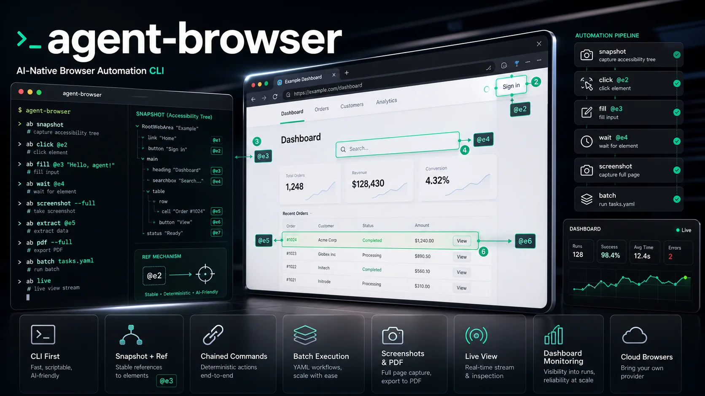

# agent-browser：Vercel 出品的 AI 原生浏览器自动化 CLI

**一句话定位：** agent-browser 是 Vercel Labs 开源的浏览器自动化 CLI，用 Rust 编写，专为 AI Agent 设计。核心特点是 **Snapshot + Ref 机制** 让 LLM 能精准操作网页，同时支持命令链式调用、批量执行、实时画面流、Dashboard 监控，以及多种云浏览器提供商接入。目前 34.8k Stars。




---

## 一、安装

**npm（推荐）**

```bash
npm install -g agent-browser
agent-browser install   # 首次下载 Chrome for Testing
```

**Homebrew（macOS）**

```bash
brew install agent-browser
agent-browser install
```

**Cargo（Rust）**

```bash
cargo install agent-browser
agent-browser install
```

首次需要跑 `agent-browser install` 下载自动化专用 Chrome。如果你本地已有 Chrome、Brave、Playwright 或 Puppeteer 的 Chrome，它会自动检测复用。

升级也很简单：

```bash
agent-browser upgrade   # 自动识别安装方式并更新
```

---

## 二、核心设计：Snapshot + Ref

这是 agent-browser 和传统自动化工具（Puppeteer/Playwright）最大的区别。

传统方式是用 CSS 选择器或 XPath 定位元素，容易因为页面结构变化而失效。agent-browser 的做法是：

**1. 先拍快照（Snapshot）**

```bash
agent-browser open example.com
agent-browser snapshot
```

输出是一个 accessibility tree，每个交互元素都带有一个 ref：

```
- heading "Example Domain" [ref=e1] [level=1]
- button "Submit" [ref=e2]
- textbox "Email" [ref=e3]
- link "Learn more" [ref=e4]
```

**2. 用 ref 精准操作**

```bash
agent-browser click @e2
agent-browser fill @e3 "test@example.com"
agent-browser get text @e1
```

**为什么这种方式更适合 AI？**

- **确定性**：ref 绑定的是快照里的具体元素，不会因为页面动态变化而错位
- **快速**：不需要重新查询 DOM
- **LLM 友好**：AI 先读 snapshot，再决定操作哪个 ref，整个流程自然畅通

加上 `-i` 参数可以只输出交互元素，减少噪音：

```bash
agent-browser snapshot -i
```

---

## 三、基础操作命令

agent-browser 的命令设计得很直观，基本覆盖日常自动化需求：

### 导航与页面操作

```bash
agent-browser open example.com          # 打开页面
agent-browser open                      # 只启动浏览器（停在 about:blank）
agent-browser back                      # 后退
agent-browser forward                   # 前进
agent-browser reload                    # 刷新
agent-browser pushstate /new-path       # SPA 客户端路由
```

### 元素交互

```bash
agent-browser click @e1                 # 点击
agent-browser dblclick @e2              # 双击
agent-browser fill @e3 "text"           # 清空并填充
agent-browser type @e3 "text"           # 输入（不清空）
agent-browser hover @e4                 # 悬停
agent-browser select @e5 "option"       # 下拉框选择
agent-browser check @e6                 # 勾选复选框
agent-browser uncheck @e6               # 取消勾选
agent-browser scroll down 500           # 滚动
agent-browser scrollintoview @e7        # 滚动到元素可见
agent-browser drag @src @tgt            # 拖拽
agent-browser upload @e8 "./file.pdf"   # 上传文件
```

### 键盘操作

```bash
agent-browser press Enter               # 按键
agent-browser press "Control+a"         # 组合键
agent-browser keyboard type "hello"     # 模拟真实按键输入
agent-browser keydown Shift             # 按住
agent-browser keyup Shift               # 释放
```

### 截图与 PDF

```bash
agent-browser screenshot page.png       # 截图当前视口
agent-browser screenshot --full page.png # 整页截图
agent-browser screenshot --annotate    # 带元素编号标注的截图（方便 AI 识别）
agent-browser pdf page.pdf              # 保存为 PDF
```

---

## 四、等待机制：处理异步加载

现代网页很多内容是异步加载的，agent-browser 提供了多种等待方式：

```bash
# 等待元素出现
agent-browser wait "#submit-button"

# 等待固定时间
agent-browser wait 3000

# 等待文本出现
agent-browser wait --text "Welcome"

# 等待 URL 匹配
agent-browser wait --url "**/dashboard"

# 等待页面加载完成
agent-browser wait --load networkidle

# 等待 JS 条件满足
agent-browser wait --fn "window.ready === true"

# 等待元素消失
agent-browser wait "#spinner" --state hidden
```

**加载状态选项：** `load`（页面完全加载）、`domcontentloaded`（DOM 就绪）、`networkidle`（网络空闲）

---

## 五、批量执行：减少进程启动开销

每个 agent-browser 命令默认会复用后台 daemon，已经比传统方案快很多。但如果要执行一连串操作，用 `batch` 可以进一步减少开销：

```bash
# 参数模式
agent-browser batch "open https://example.com" "snapshot -i" "screenshot"

# 出错即停
agent-browser batch --bail "open https://example.com" "click @e1" "screenshot"

# JSON 管道模式
echo '[
  ["open", "https://example.com"],
  ["snapshot", "-i"],
  ["click", "@e1"],
  ["screenshot", "result.png"]
]' | agent-browser batch --json
```

---

## 六、命令链式调用

在 shell 里用 `&&` 串联命令，browser session 会在后台保持：

```bash
# 打开、等加载、截图一气呵成
agent-browser open example.com && agent-browser wait --load networkidle && agent-browser screenshot page.png

# 填表单并提交
agent-browser fill @e1 "user@example.com" && agent-browser fill @e2 "pass" && agent-browser click @e3
```

适合不需要解析中间输出的场景。如果需要先读 snapshot 再决定操作哪个 ref，就得分步执行。

---

## 七、信息获取与状态检查

```bash
# 获取元素内容
agent-browser get text @e1              # 文本内容
agent-browser get html @e1              # innerHTML
agent-browser get value @e2             # input 值
agent-browser get attr @e1 href         # 属性值
agent-browser get title                 # 页面标题
agent-browser get url                   # 当前 URL
agent-browser get count ".item"         # 匹配元素数量
agent-browser get box @e1               # 元素边界框

# 状态检查
agent-browser is visible @e1            # 是否可见
agent-browser is enabled @e1            # 是否可用
agent-browser is checked @e1            # 是否勾选
```

加上 `--json` 参数可以输出结构化数据，方便程序解析：

```bash
agent-browser snapshot --json
agent-browser get text @e1 --json
```

---

## 八、语义化定位：不用选择器也能找元素

除了 CSS 选择器和 ref，agent-browser 还支持语义化定位，对可读性很友好：

```bash
# 按 ARIA role
agent-browser find role button click --name "Submit"

# 按文本内容
agent-browser find text "Sign In" click

# 按 label
agent-browser find label "Email" fill "test@test.com"

# 按 placeholder
agent-browser find placeholder "Search" fill "query"

# 按 alt 文本
agent-browser find alt "Logo" click

# 按 testid
agent-browser find testid "submit-btn" click

# 取第 N 个匹配
agent-browser find nth 2 "a" text

# 第一个/最后一个
agent-browser find first ".item" click
agent-browser find last ".item" click
```

**支持的动作：** `click`, `fill`, `type`, `hover`, `focus`, `check`, `uncheck`, `text`

---

## 九、网络拦截与监控

```bash
# 拦截特定 URL
agent-browser network route "*api*"

# 阻断请求
agent-browser network route "*google-analytics*" --abort

# 模拟响应
agent-browser network route "*api/users" --body '{"users":[]}'

# 按资源类型阻断（如屏蔽所有脚本）
agent-browser network route '*' --abort --resource-type script

# 查看请求列表
agent-browser network requests
agent-browser network requests --filter api
agent-browser network requests --type xhr,fetch
agent-browser network requests --method POST
agent-browser network requests --status 2xx

# 查看单个请求详情
agent-browser network request <requestId>

# HAR 录制
agent-browser network har start
agent-browser network har stop output.har
```

---

## 十、Tab 与窗口管理

```bash
# 列出所有 tab
agent-browser tab

# 新建 tab
agent-browser tab new https://docs.example.com

# 新建 tab 并加标签（方便后续引用）
agent-browser tab new --label docs https://docs.example.com

# 切换 tab（用 id 或 label）
agent-browser tab t2
agent-browser tab docs

# 关闭 tab
agent-browser tab close t2
agent-browser tab close docs

# 新建窗口
agent-browser window new
```

Tab id 是稳定的（如 `t1`, `t2`），关闭其他 tab 后 id 也不会重用，脚本里可以放心引用。

---

## 十一、Cookie 与存储

```bash
# Cookie
agent-browser cookies                           # 获取所有
agent-browser cookies set sessionId abc123      # 设置单个
agent-browser cookies set --curl cookies.txt    # 从 cURL dump 导入
agent-browser cookies clear                     # 清空

# localStorage
agent-browser storage local                     # 获取全部
agent-browser storage local myKey               # 获取某个 key
agent-browser storage local set myKey myValue   # 设置
agent-browser storage local clear               # 清空

# sessionStorage（同上）
agent-browser storage session
```

---

## 十二、Diff 功能：对比页面变化

agent-browser 内置了 diff 能力，很适合做回归测试：

```bash
# 对比当前 snapshot 和上一次
agent-browser diff snapshot

# 对比当前 snapshot 和基准文件
agent-browser diff snapshot --baseline before.txt

# 截图对比（像素级）
agent-browser diff screenshot --baseline before.png

# 对比两个 URL
agent-browser diff url https://v1.com https://v2.com
agent-browser diff url https://v1.com https://v2.com --screenshot
```

---

## 十三、调试与诊断

```bash
# 诊断环境
agent-browser doctor
agent-browser doctor --fix          # 自动修复
agent-browser doctor --offline --quick  # 跳过网络检查

# 追踪录制
agent-browser trace start
agent-browser trace stop trace.zip

# 性能分析
agent-browser profiler start
agent-browser profiler stop profile.json

# 查看控制台输出
agent-browser console
agent-browser console --json

# 查看页面错误
agent-browser errors

# 高亮元素
agent-browser highlight @e1

# 打开 Chrome DevTools
agent-browser inspect
```

---

## 十四、AI Chat：自然语言控制浏览器

agent-browser 集成了 Vercel AI Gateway，可以直接用自然语言控制浏览器：

```bash
# 单轮指令
agent-browser chat "open google.com and search for cats"

# 交互式 REPL
agent-browser chat
# > take a screenshot
# > click the first result

# 安静模式（只输出 AI 回复）
agent-browser -q chat "summarize this page"

# 详细模式（显示底层命令执行）
agent-browser -v chat "fill in the login form"
```

需要配置环境变量：

```bash
export AI_GATEWAY_API_KEY=***
export AI_GATEWAY_MODEL=anthropic/claude-sonnet-4.6   # 默认
export AI_GATEWAY_URL=https://ai-gateway.vercel.sh     # 默认
```

---

## 十五、Dashboard 实时监控

启动本地 Web Dashboard，可以在浏览器里实时观看 AI 操作：

```bash
agent-browser dashboard start           # 默认端口 4848
agent-browser dashboard start --port 8080

# 之后正常执行命令，画面会自动同步到 dashboard
agent-browser open example.com
agent-browser snapshot

# 停止 dashboard
agent-browser dashboard stop
```

Dashboard 显示内容：
- **实时画面**：浏览器视口的 JPEG 帧流
- **活动流**：命令执行历史和时间线
- **控制台输出**：log / warn / error
- **会话管理**：创建新会话
- **AI Chat**：在 Dashboard 里直接和 AI 对话

---

## 十六、Streaming：实时画面流

每个 session 默认会启动一个 WebSocket server，可以通过 WebSocket 接收浏览器画面或发送输入事件：

```bash
# 查看当前流的端口
agent-browser stream status

# 指定端口
AGENT_BROWSER_STREAM_PORT=9223 agent-browser open example.com

# 启停控制
agent-browser stream enable --port 9223
agent-browser stream disable
```

WebSocket 协议支持接收 `frame`（base64 JPEG）、发送 `input_mouse`、`input_keyboard`、`input_touch` 事件。适合做人机协同的 "pair browsing" 场景。

---

## 十七、配置持久化

不想每次敲一堆参数？用配置文件：

```json
// agent-browser.json（项目级）
{
  "headed": true,
  "proxy": "http://localhost:8080",
  "screenshotFormat": "jpeg",
  "screenshotQuality": 80
}
```

配置优先级（低到高）：

1. `~/.agent-browser/config.json` — 用户级默认
2. `./agent-browser.json` — 项目级覆盖
3. `AGENT_BROWSER_*` 环境变量
4. CLI 参数

---

## 十八、云浏览器提供商

如果本地不能跑浏览器（比如 serverless 环境），agent-browser 支持直接接入云浏览器：

| 提供商 | 启用方式 |
|---|---|
| **Browserbase** | `-p browserbase` + `BROWSERBASE_API_KEY` |
| **Browserless** | `-p browserless` + `BROWSERLESS_API_KEY` |
| **Browser Use** | `-p browseruse` + `BROWSER_USE_API_KEY` |
| **Kernel** | `-p kernel` + `KERNEL_API_KEY` |
| **AgentCore** | `-p agentcore`（AWS Bedrock，自动读 AWS 凭证） |

切换后所有命令行为完全一致，只是后端换成了云端浏览器。

---

## 十九、iOS 模拟器支持

agent-browser 可以控制 iOS Simulator 里的 Safari，做真机移动测试：

```bash
# 列出可用设备
agent-browser device list

# 在 iPhone 16 Pro 上打开页面
agent-browser -p ios --device "iPhone 16 Pro" open https://example.com

# 同样的命令
agent-browser -p ios snapshot -i
agent-browser -p ios tap @e1
agent-browser -p ios swipe up
agent-browser -p ios screenshot mobile.png
```

需要提前安装 Appium 和 XCUITest driver。首次启动模拟器大约 30-60 秒，后续命令很快。

---

## 二十、典型 AI Agent 工作流

把上面的命令组合起来，一个完整的 AI 浏览器自动化工作流是这样的：

```bash
# 1. 打开目标页面
agent-browser open https://example.com/login

# 2. 获取带 ref 的快照
agent-browser snapshot -i --json

# 3. AI 从 snapshot 里识别出：
#    @e1 = Email 输入框, @e2 = Password 输入框, @e3 = Submit 按钮

# 4. 执行操作
agent-browser fill @e1 "user@example.com"
agent-browser fill @e2 "password"
agent-browser click @e3

# 5. 等待页面跳转
agent-browser wait --url "**/dashboard"

# 6. 重新快照确认状态
agent-browser snapshot -i --json

# 7. 截图留存
agent-browser screenshot result.png
```

或者写成 batch：

```bash
agent-browser batch \
  '["open","https://example.com/login"]' \
  '["snapshot","-i"]' \
  '["fill","@e1","user@example.com"]' \
  '["fill","@e2","password"]' \
  '["click","@e3"]' \
  '["wait","--url","**/dashboard"]' \
  '["screenshot","result.png"]'
```

---

## 写在最后

agent-browser 的定位不是替代 Puppeteer/Playwright，而是做**专为 AI Agent 优化的浏览器 CLI**。它的 Snapshot + Ref 机制、原生 Rust 性能、命令链式调用、batch 批量执行、内置 AI Chat、Dashboard 监控，都是围绕「让 AI 更高效地操作浏览器」这个核心目标设计的。

如果你在做 AI Agent、自动化测试、网页爬虫、或者需要让 LLM 能看懂并操作网页，agent-browser 值得投入时间试试。

GitHub：https://github.com/vercel-labs/agent-browser  
文档：https://agent-browser.dev
