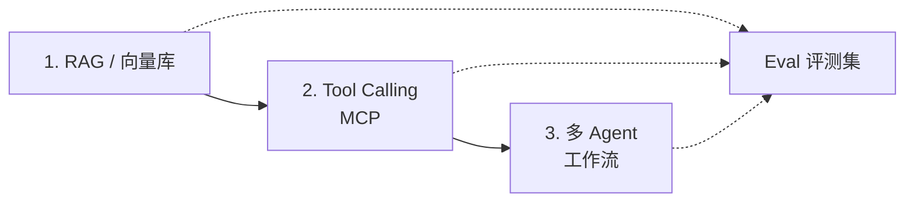

# AI FDE 入门知识图谱

**一句话定位：** AI FDE（Forward Deployed Engineer）把 frontier 模型从 demo 做成**客户现场可上线、可度量业务结果**的生产系统；成功标准是采纳率与工作流影响，并把一线反馈反哺产品。

本文是一张**入门知识图谱**：按「能交付」组织能力与学习路径，而不是课程清单。内容综合 OpenAI / Anthropic / Palantir / Google Cloud / AWS / Salesforce 等公开 JD 与常见落地实践。

---

## 一、总览图

从上到下：**定位 → 五大支柱 → 关键技术 → 交付闭环**。能力进入闭环的位置见下表。

```mermaid
flowchart TB
  FDE["AI FDE<br/>现场把模型做成<br/>可上线业务结果"]

  subgraph L1["五大支柱"]
    direction TB
    B1["业务穿透"] --> B2["AI 原生工程"] --> B3["系统集成胶水"] --> B4["生产确定性"] --> B5["陪跑与沉淀"]
  end

  subgraph L2["业务穿透"]
    direction TB
    D1["访谈 / 流程还原"] --> D2["伪需求过滤"] --> D3["MVP 与验收指标"] --> D4["ROI / 成功标准"]
  end

  subgraph L3["AI 原生工程"]
    direction TB
    A1["LLM 行为与成本"] --> A2["Prompt / Spec"] --> A3["RAG / 向量库"] --> A4["Tool Calling<br/>MCP"] --> A5["多 Agent<br/>工作流图"] --> A6["Eval 评测集"]
  end

  subgraph L4["系统集成"]
    direction TB
    S1["API / Webhook"] --> S2["鉴权 SSO / 权限"] --> S3["数据管道 ETL"] --> S4["企业系统<br/>ERP CRM OA"] --> S5["Docker K8s<br/>私有化"]
  end

  subgraph L5["生产确定性"]
    direction TB
    P1["监控日志 tracing"] --> P2["护栏 /<br/>人工确认点"] --> P3["失败重试与回退"] --> P4["安全合规审计"] --> P5["事故排查"]
  end

  subgraph L6["陪跑沉淀"]
    direction TB
    C1["现场演示与培训"] --> C2["SOP / Playbook"] --> C3["可复用<br/>Skill 连接器"] --> C4["反馈反哺产研"]
  end

  subgraph L7["交付闭环"]
    direction TB
    T1["发现"] --> T2["方案与范围"] --> T3["POC"] --> T4["集成上线"] --> T5["运维优化"] --> T6["资产化复用"]
  end

  FDE --> L1 --> L2 --> L3 --> L4 --> L5 --> L6 --> L7
```

### 怎么读这张图

| 支柱 | 一句话 |
|---|---|
| **业务穿透** | 听懂现场、过滤伪需求，收敛成可验收 MVP |
| **AI 原生工程** | RAG → Tool → 工作流；Eval 贯穿始终 |
| **系统集成** | AI 必须插进客户已有系统，不是单独聊天窗 |
| **生产确定性** | 护栏、可观测、合规——与玩具 demo 的分界线 |
| **陪跑沉淀** | 单次定制 → 模板 / Skill，避免永远外包式交付 |

能力怎么接到闭环上：

| 能力 | 进入阶段 |
|---|---|
| MVP 与验收指标 | 发现 |
| RAG / Tool / 工作流图 | POC |
| API、私有化部署 | 集成上线 |
| 监控、护栏 | 运维优化 |
| SOP、可复用 Skill | 资产化复用 |

---

## 二、岗位本质（对照真实 JD）

公开岗位（OpenAI FDE、Anthropic Applied AI FDE、Palantir Forward Deployed AI Engineer、Google Cloud GenAI FDE、AWS FDE、Salesforce Agentforce FDE 等）高度一致：

1. **驻场 / 高频对接**战略客户，出差常见 25%–50%。
2. **端到端交付**：发现 → 范围 → 设计 → 编码 → 上线 → 运维。
3. **成功标准**：生产采纳、可度量工作流影响、eval 驱动反馈。
4. **反哺产品**：把可复用模式沉淀为 playbook / 连接器 / 平台能力。

和普通 AI 工程师的差别：**在客户环境对业务结果兜底**，不是只刷榜或只做平台功能；也不是纯售前——必须下场写代码、集成、上线。

---

## 三、硬技能图谱

### 3.1 生产级工程（底座）

- 语言：以 **Python** 为主，常配合 TypeScript / JavaScript
- 能独立完成：API、简单前端、数据管道、权限、部署
- 工具：Git、Linux、Docker；加分 K8s、CI/CD、云（AWS / GCP / Azure）

### 3.2 AI 原生工程（核心差异）

按学习顺序：

#### RAG / 向量库

- 概念：切分、embedding、召回、重排、引用溯源、幻觉控制
- 练手：熟悉文档入库 → 带出处问答（Chroma / Qdrant / pgvector 任选）
- 进阶：混合检索、评测集、增量更新

#### Tool Calling / MCP

- 概念：工具 schema、参数校验、失败重试、权限边界
- 练手：3–5 个真实工具（读文件、调内部 API 等）
- 进阶：并行工具、结果压缩、MCP 客户端

#### 多 Agent / 工作流

- 概念：状态机 / 图、角色分工、人机确认点、失败回退
- 练手：规划 → 检索 → 执行 → 校验 四步流水线（LangGraph 或自写状态机）
- 进阶：子 Agent、共享记忆、轨迹评测（pass@k、成本、步数）

### 3.3 系统集成与私有化

- API / Webhook、SSO、数据脱敏
- 对接 ERP / CRM / OA / 工单等
- Docker / K8s、内网、私有云适配

### 3.4 生产确定性

- 监控、日志、tracing
- 护栏与人工确认点（Agent 会「高效做错」）
- 安全合规、审计、事故排查

---

## 四、软技能与工作方式

- **需求澄清与范围控制**：问清成功标准，挡住无限改需求
- **双语沟通**：对工程师讲技术方案，对业务讲价值与验收
- **节奏感**：2–4 周可验证的 MVP，而不是憋大招
- **产品化意识**：定制交付 → 可复用资产

---

## 五、入门最短路径（4–6 周）

| 周次 | 目标 | 完成标准 |
|---|---|---|
| 1–2 | RAG 问答上线 | 带出处回答 + 简单评测 |
| 2–3 | 加上 Tool Calling | 至少 2 个真实工具可调用 |
| 4–6 | 可观测工作流图 | 可回放、可单步调试 + 交付笔记 |

**简历级交付物（一个仓库）：**

1. 知识库 RAG
2. ≥2 个业务工具 / MCP
3. 可画出的 agent 图
4. eval 脚本
5. README：业务问题 → 指标 → 架构 → 失败案例

---

## 六、交付闭环检查清单

### 发现

- [ ] 业务痛点用指标写清（基线 → 目标）
- [ ] 已过滤「全能助手」类伪需求
- [ ] 锁定 2–4 周可验证的 MVP

### POC

- [ ] RAG / Tool / 流程能跑通真实数据子集
- [ ] 有最小评测集（正例 / 难例 / 拒答）
- [ ] 客户能看到可演示产物

### 上线

- [ ] 鉴权与权限边界明确
- [ ] 监控、日志、失败重试到位
- [ ] 关键写操作有人工确认点

### 沉淀

- [ ] SOP / Playbook 已写
- [ ] 共性能力抽成 Skill / 连接器 / 模板
- [ ] 反馈已同步产研（若有）

---

## 七、常见坑

1. **只做聊天窗**：不接业务系统，无法改变工作流。
2. **万能 Prompt**：复杂业务必须状态机 / 图，不能靠一段长提示。
3. **无 Eval**：无法证明变好，也无法守住回归。
4. **无护栏**：Agent 会把错误方向高效执行到底。
5. **不沉淀**：每次从零定制，永远像人力外包。

---

## 八、延伸阅读（公开来源）

- OpenAI Careers：Forward Deployed Engineer
- Anthropic：Forward Deployed Engineer（Applied AI）
- Palantir：Forward Deployed AI Engineer
- Google Cloud / AWS / Salesforce 的 GenAI / Agent FDE JD
- Anthropic：Building effective agents
- Model Context Protocol（MCP）规范与示例

---

## 写在最后

FDE 的核心不是「会更多模型名字」，而是：**在模糊与受限的客户环境里，把 AI 接到真实系统上，交付可验收的业务结果，并把经验变成可复制资产。**

按本文图谱：先业务与验收，再 RAG → Tool → 工作流，始终带着 Eval 与护栏，最后才谈多 Agent 炫技。
