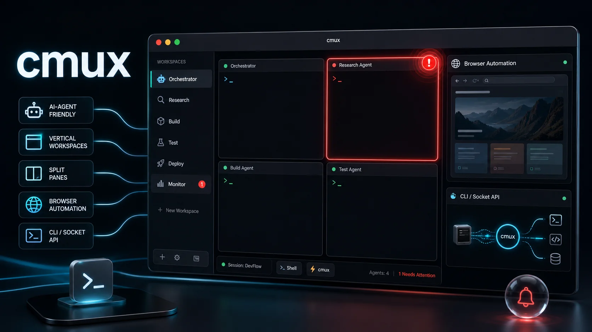
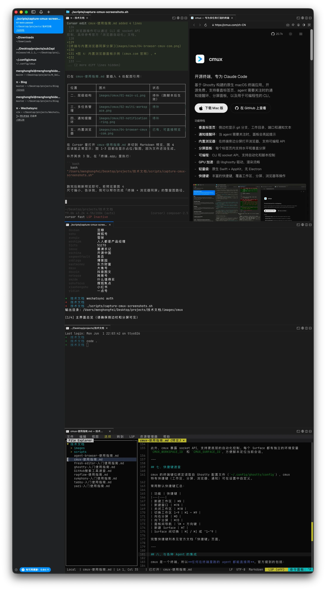
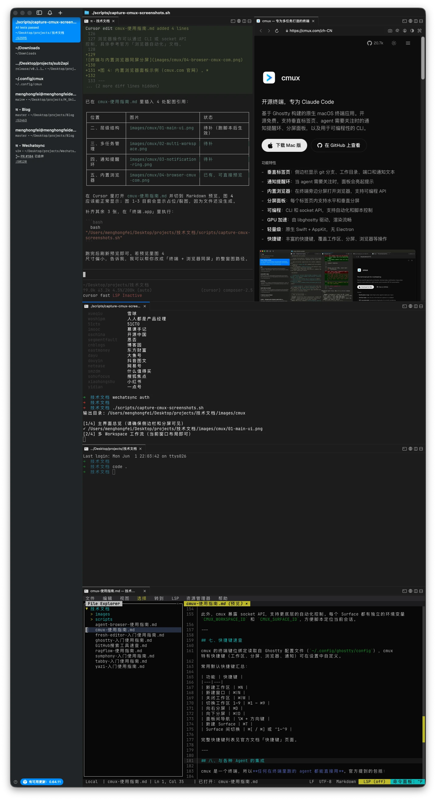
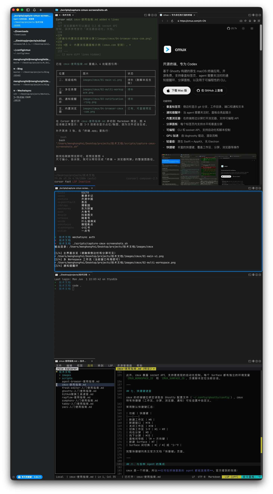
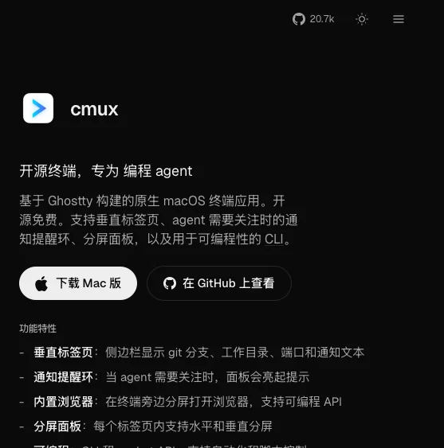

# cmux：专为 AI Agent 和多任务设计的 macOS 终端

**一句话定位：** cmux 是基于 Ghostty 渲染引擎构建的原生 macOS 终端应用，核心卖点是**垂直标签页管理、Agent 通知提醒环、内置浏览器、分屏面板和 CLI/socket 可编程 API**。它不是 Ghostty 的 fork，而是一个独立的应用层。

目前仅支持 macOS 14.0+（Apple Silicon / Intel），开源免费。




---

## 一、安装与初始化

**方式一：DMG（推荐）**

从 [cmux.com](https://cmux.com) 下载 `.dmg`，拖到「应用程序」文件夹即可。后续通过 Sparkle 自动更新。

**方式二：Homebrew**

```bash
brew tap manaflow-ai/cmux
brew install --cask cmux
```

更新时执行 `brew upgrade --cask cmux`。

首次打开时 macOS 会提示「来自已识别的开发者」，点击「打开」即可。

---

## 二、理解 cmux 的层级结构

cmux 用四层结构组织终端，搞清楚这个才能用好快捷键和 API：

```
Window（窗口）
  └── Workspace（工作区 / 侧边栏标签）
        └── Pane（分屏区域）
              └── Surface（面板内的标签页）
                    └── Panel（终端或浏览器内容）
```

| 层级 | 是什么 | 创建方式 | 标识 |
|---|---|---|---|
| **Window** | macOS 窗口 | ⌘⇧N | — |
| **Workspace** | 左侧边栏条目 | ⌘N | `CMUX_WORKSPACE_ID` |
| **Pane** | 分屏区域 | ⌘D（右分屏）/ ⌘⇧D（下分屏） | Pane ID |
| **Surface** | 面板内的标签页 | ⌘T | `CMUX_SURFACE_ID` |
| **Panel** | 终端或浏览器 | 自动创建 | Panel ID |

**关键理解：** 侧边栏里你看到的每个条目就是一个 Workspace，cmux 在 UI 里通常叫它「标签页」；而面板内的标签页叫 Surface，不要搞混。

---



## 三、多任务管理：工作区 + 分屏

cmux 的侧边栏垂直排列所有 Workspace，这是它区别于传统终端/iTerm2 最直观的地方。

### 工作区操作

| 操作 | 快捷键 |
|---|---|
| 新建工作区 | ⌘N |
| 切换工作区 | ⌘1 ~ ⌘9 |
| 关闭当前工作区 | ⌘⇧W |
| 上一个/下一个工作区 | ⌃⌘[ / ⌃⌘] |

你可以给不同任务分配独立工作区：比如「dev」写代码、「server」跑服务、「logs」看日志，每个工作区有自己的分屏布局和 Surface。

### 分屏操作

| 操作 | 快捷键 |
|---|---|
| 向右分屏 | ⌘D |
| 向下分屏 | ⌘⇧D |
| 在面板间切换 | ⌥⌘ + 方向键 |
| 关闭当前面板 | ⌘W |

每个 Pane 内还可以创建多个 Surface（⌘T 新建，⌘[ / ⌘] 切换）。

---



## 四、通知提醒环：Agent 需要关注时不会错过

这是 cmux 专为 coding agent 设计的杀手级功能。

当终端里的进程需要输入或 attention 时，cmux 会通过以下方式提醒你：

- **通知环**：面板周围亮起提示光环
- **侧边栏未读标记**：对应工作区显示红点
- **通知面板**：弹出通知浮层
- **macOS 桌面通知**：系统级推送

触发方式有两种：

**1. 自动触发**：Agent（如 Claude Code、Codex）通过标准终端转义序列（OSC 9/99/777）自动发送通知。

**2. 手动触发**：通过 CLI 或脚本主动发送。

```bash
cmux notify --title "Build Complete" --body "编译完成"
```

当你同时跑多个 Agent 或多个长任务时，这个通知系统能避免你反复切窗口检查状态。

---



## 五、内置浏览器：终端旁边直接看网页

cmux 支持在终端面板旁边直接打开一个浏览器视图，而且**支持可编程 API**。

这在以下场景特别实用：

- Agent 需要你确认网页内容时，不用切到 Chrome
- 跑前端项目时，终端 + 浏览器在同一窗口内分屏
- 通过 API 自动化浏览器操作（比如截图、点击）

浏览器操作可以通过 CLI 或 socket API 控制，具体参考官方「浏览器自动化」文档。

---



## 六、CLI 与 Socket API：自动化脚本控制

cmux 内置 CLI 工具，默认在 cmux 终端内自动可用。如果要在外部使用，创建符号链接：

```bash
sudo ln -sf "/Applications/cmux.app/Contents/Resources/bin/cmux" /usr/local/bin/cmux
```

常用 CLI 命令：

```bash
# 列出所有工作区
cmux list-workspaces

# 发送通知
cmux notify --title "Build Complete" --body "编译完成"

# 浏览器自动化操作（详见文档）
```

此外，cmux 暴露 socket API，支持更底层的自动化控制。每个 Surface 都有独立的环境变量 `CMUX_WORKSPACE_ID` 和 `CMUX_SURFACE_ID`，方便脚本定位当前会话。

---

## 七、快捷键速查

cmux 的终端键位绑定读取自 Ghostty 配置文件（`~/.config/ghostty/config`），cmux 特有快捷键（工作区、分屏、浏览器、通知）可在设置中自定义。

常用默认快捷键汇总：

| 功能 | 快捷键 |
|---|---|
| 新建工作区 | ⌘N |
| 新建窗口 | ⌘⇧N |
| 关闭工作区 | ⌘⇧W |
| 切换工作区 1~9 | ⌘1 ~ ⌘9 |
| 向右分屏 | ⌘D |
| 向下分屏 | ⌘⇧D |
| 面板间导航 | ⌥⌘ + 方向键 |
| 新建 Surface | ⌘T |
| Surface 间切换 | ⌘[ / ⌘] 或 ⌃1~⌃9 |

完整快捷键列表见官方文档「快捷键」页面。

---

## 八、与各种 Agent 的集成

cmux 是一个终端，所以**任何在终端里跑的 agent 都能直接用**。官方提到的包括：

Claude Code、Codex、OpenCode、Gemini CLI、Kiro、Aider、Goose、Amp、Cline、Cursor Agent……

cmux 还提供了一些专门的 Agent 集成插件：
- Claude Code Teams 集成
- oh-my-opencode / oh-my-codex / oh-my-claudecode

---

## 九、会话恢复（当前实现）

重启 cmux 后，它会恢复**窗口布局、工作区列表和元数据**，但**不会恢复实时进程状态**。也就是说，之前跑的 Claude Code、tmux、vim 会话不会自动恢复，需要重新启动。

对于 Agent 场景，可以通过 hook 脚本实现部分会话恢复。

---

## 十、cmux vs tmux vs iTerm2

| 特性 | cmux | tmux | iTerm2 |
|---|---|---|---|
| 垂直标签页 | ✅ 原生侧边栏 | ❌ 需要配置 | ❌ |
| 通知提醒环 | ✅ 原生 | ❌ 需脚本 | ❌ |
| 内置浏览器 | ✅ | ❌ | ❌ |
| GUI 原生应用 | ✅ Swift/AppKit | ❌ 终端内复用器 | ✅ |
| 可编程 API | ✅ CLI + Socket | ✅ 命令丰富 | ⚠️ 有限 |
| 跨平台 | ❌ 仅 macOS | ✅ | ✅ macOS |

简单总结：**如果你主要在 macOS 上用终端跑 AI Agent、需要同时管理多个任务流、希望有直观的通知和分屏体验，cmux 值得一试。** 如果你需要跨平台或重度依赖 tmux 的会话持久化，可以暂时观望。

---

## 写在最后

cmux 的定位很明确：不是做一个通用终端，而是做一个**面向 AI Agent 工作流的生产力终端**。它的垂直标签页、通知环、内置浏览器和可编程 API 都是围绕「多任务并行 + Agent 交互」这个场景设计的。

如果你已经在用 Claude Code、Codex 或其他终端 Agent，不妨花半小时试试 cmux，看看它的侧边栏管理和通知系统能不能帮你减少切窗口的频次。

官网：https://cmux.com  
GitHub：开源，可自行编译或提 issue
