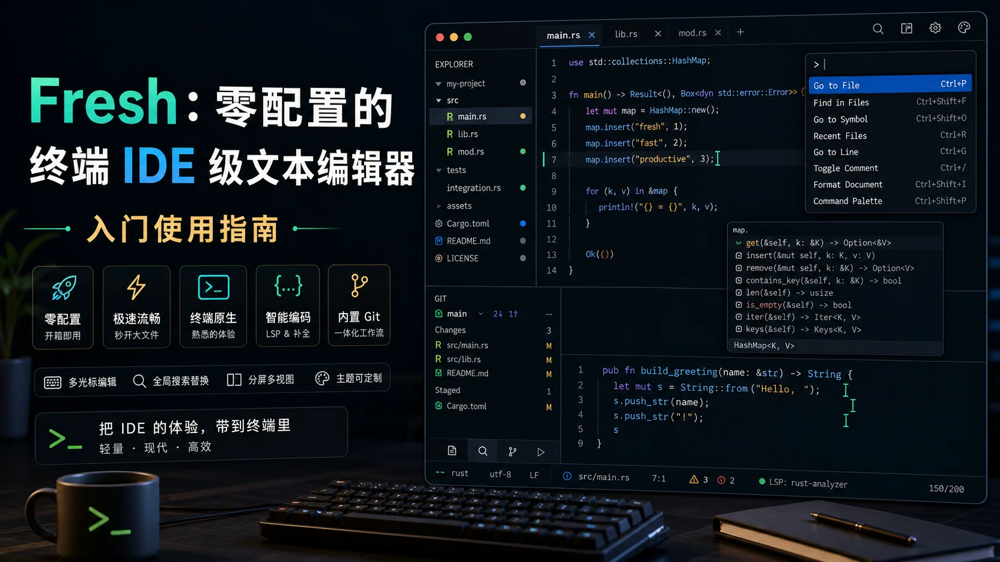

# Fresh：零配置的终端 IDE 级文本编辑器

**一句话定位：** Fresh 是一个现代的、功能齐全的终端文本编辑器，用 Rust 编写，核心卖点是**零配置开箱即用**——把 VS Code/Sublime Text 的直观体验带到终端里，支持鼠标、命令面板、多光标、LSP、插件扩展，还能秒开多 GB 大文件。目前 GitHub 7.4k+ Stars。




---

## 一、安装

Fresh 支持几乎所有主流平台，选一种适合你的方式即可。

### macOS（Homebrew，推荐）

```bash
brew install fresh-editor
```

> 首次使用建议看一下 [macOS Terminal Tips](https://getfresh.dev/docs/configuration/keyboard#macos-terminal-tips)，配置一下终端键位转发。

### Windows（winget）

```bash
winget install fresh-editor
```

### Linux

| 发行版 | 命令 |
|--------|------|
| Debian/Ubuntu | 下载 `.deb` 从 [Releases](https://github.com/sinelaw/fresh/releases) 安装 |
| Fedora/RHEL | 下载 `.rpm` 安装，或用 Terra 仓库 |
| Arch Linux | `yay -S fresh-editor-bin` |
| OpenSUSE | `zypper install fresh-editor` |
| Gentoo | `emerge --ask app-editors/fresh` |
| 通用 | AppImage / Flatpak / 预编译二进制 |

### 一键脚本（跨平台自动检测）

```bash
curl https://raw.githubusercontent.com/sinelaw/fresh/refs/heads/master/scripts/install.sh | sh
```

### npm（想快速体验不安装）

```bash
npx @fresh-editor/fresh-editor
```

### Rust 用户

```bash
# 最快方式，不用编译
cargo install cargo-binstall
cargo binstall fresh-editor

# 或从 crates.io 编译安装
cargo install --locked fresh-editor
```

---

## 二、启动与基本操作

### 启动

```bash
fresh                    # 打开空编辑器
fresh file.txt           # 打开指定文件
fresh /path/to/project   # 打开整个目录
```

### 核心设计理念

Fresh 最大的特点是**无模式、无学习曲线**——不像 Vim/Emacs 需要记一堆快捷键，Fresh 的键位和 VS Code/Sublime Text 基本一致，打开就会用。

---

## 三、命令面板：一个快捷键搞定一切

**快捷键：** `Ctrl+Shift+P`（macOS 上通常是 `Cmd+Shift+P`，具体取决于终端配置）

命令面板是 Fresh 的核心入口，你可以用它：

- 打开文件（模糊查找）
- 运行命令
- 切换缓冲区
- 跳转到指定行
- 切换主题、设置

**快速打开文件：** `Ctrl+P`（类似 VS Code 的 Quick Open）

---

## 四、编辑功能

### 多光标编辑

和 VS Code/Sublime 一样，支持多光标同时编辑：

- `Ctrl+D` — 选中当前单词的下一个匹配项
- `Alt+Click` — 在任意位置添加光标
- `Ctrl+Shift+L` — 选中所有匹配项

### 常用编辑快捷键

| 操作 | 快捷键 |
|------|--------|
| 撤销 / 重做 | `Ctrl+Z` / `Ctrl+Shift+Z` |
| 复制 / 剪切 / 粘贴 | `Ctrl+C` / `Ctrl+X` / `Ctrl+V` |
| 全选 | `Ctrl+A` |
| 查找 | `Ctrl+F` |
| 替换 | `Ctrl+H` |
| 跳转到行 | `Ctrl+G` |
| 注释/取消注释 | `Ctrl+/` |
| 移动行（上/下） | `Alt+↑` / `Alt+↓` |
| 块选择（列模式） | `Shift+Alt+鼠标拖动` |
| 排序行 | 命令面板搜索 "Sort Lines" |

### 搜索与替换

- **增量搜索**：`Ctrl+F`，输入即搜
- **在选区内查找**：先选中文本再按 `Ctrl+F`
- **全局替换**：`Ctrl+H`
- **Git Grep**：在项目中用 git grep 搜索

---

## 五、文件与项目管理

### 文件资源管理器

左侧内置文件树，支持：

- 浏览目录结构
- 新建/删除/重命名文件
- 自动刷新（文件在外部被修改时自动 revert）
- Git 文件状态标识

### Tab 标签页

- `Ctrl+Tab` / `Ctrl+Shift+Tab` — 切换标签
- `Ctrl+W` — 关闭当前标签
- 支持预览标签（单击文件预览，双击固定）

### 分屏（Split View）

支持水平/垂直分屏，同时查看多个文件：

- 命令面板搜索 "Split Editor"
- 支持多个 Pane 之间的导航

---

## 六、IDE 级功能

### LSP 集成（语言服务器协议）

Fresh 内置 LSP 客户端，开箱即支持：

- **Go to Definition** — 跳转到定义
- **Find References** — 查找所有引用
- **Hover** — 悬停查看类型/文档
- **Code Actions** — 快速修复
- **Rename** — 重命名符号
- **Diagnostics** — 实时错误/警告提示
- **Autocompletion** — 自动补全

**配置 LSP：**

Fresh 会自动检测常见语言服务器，你也可以在配置中显式指定：

```typescript
// init.ts（启动脚本）
// 示例：配置 TypeScript 语言服务器
await fresh.lsp.configure({
  languageId: "typescript",
  command: ["typescript-language-server", "--stdio"],
});
```

### Git 集成

- Git 文件状态显示（修改、新增、未跟踪）
- 内置 Git Log 查看器
- 合并冲突高亮与解决辅助

### 诊断面板（Diagnostics Panel）

汇总当前项目所有 LSP 诊断信息（错误、警告、提示），支持一键跳转。

---

## 七、集成终端

Fresh 内置终端，不用切出编辑器就能跑命令：

- 命令面板搜索 "Toggle Terminal"
- 支持多个终端实例
- 与编辑器无缝协作（比如从终端打开文件）

---

## 八、主题与外观

### 切换主题

命令面板 → 搜索 "Select Color Theme"，实时预览切换。

Fresh 自带多套配色方案，也支持 VS Code 风格的主题格式。

### 图形化设置界面

不像传统编辑器要改配置文件，Fresh 有图形化的 Settings UI：

- 命令面板 → "Open Settings"
- 可视化编辑所有选项

---

## 九、插件系统

Fresh 支持 TypeScript 插件，基于沙盒化的 QuickJS 运行。

### 官方示例插件

- **Color Highlighter** — CSS 颜色值实时预览
- **TODO Highlighter** — TODO/FIXME 高亮
- **Merge Conflicts** — 合并冲突可视化辅助
- **Path Complete** — 路径自动补全
- **Custom Keymaps** — 键位映射扩展

### 插件开发

如果你有特殊需求，可以用 TypeScript 写自己的插件。官方提供了完整的 [Plugin API 文档](https://getfresh.dev/docs/plugins/development)。

---

## 十、进阶功能

### 大文件处理

Fresh 的亮点之一是能**秒开多 GB 文件**，内存占用极低。这得益于它的 Piece Tree 存储结构和流式渲染架构。

### 会话持久化（Session Persistence）

退出 Fresh 后重新打开，会自动恢复：

- 打开的文件列表
- 光标位置
- 分屏布局
- 工作区状态

### SSH 远程编辑

支持通过 SSH 直接编辑远程文件：

```bash
fresh ssh://user@host/path/to/project
```

### Devcontainers

Fresh 支持开发容器（Devcontainers），在隔离的容器环境中工作。

### Dashboard

启动时显示 Dashboard，包含最近打开的项目、快速入口等。

---

## 十一、配置与自定义

### 配置文件

Fresh 的配置是 JSON/TypeScript 格式，通常位于：

- **配置目录**：`~/.config/fresh-editor/`
- **启动脚本**：`~/.config/fresh-editor/init.ts`

### 启动脚本（init.ts）

用 TypeScript 写启动脚本，实现高级自定义：

```typescript
// ~/.config/fresh-editor/init.ts

// 自定义快捷键
fresh.keymap.set("ctrl+shift+t", "terminal.toggle");

// 设置主题
fresh.settings.set("theme", "dark+");

// 配置 LSP
await fresh.lsp.configure({
  languageId: "rust",
  command: ["rust-analyzer"],
});
```

### 键位编辑器

图形化的键位绑定编辑器，不用手写配置：

- 命令面板 → "Open Keybinding Editor"
- 搜索命令 → 按你想绑定的快捷键 → 完成

---

## 十二、常用快捷键速查

| 功能 | 快捷键 |
|------|--------|
| 命令面板 | `Ctrl+Shift+P` |
| 快速打开文件 | `Ctrl+P` |
| 保存 | `Ctrl+S` |
| 关闭文件 | `Ctrl+W` |
| 撤销/重做 | `Ctrl+Z` / `Ctrl+Shift+Z` |
| 查找 | `Ctrl+F` |
| 替换 | `Ctrl+H` |
| 跳转到行 | `Ctrl+G` |
| 多光标（选下一个匹配） | `Ctrl+D` |
| 注释切换 | `Ctrl+/` |
| 移动行 | `Alt+↑/↓` |
| 复制当前行 | `Ctrl+Shift+D` |
| 文件资源管理器 | 命令面板 → "Toggle File Explorer" |
| 集成终端 | 命令面板 → "Toggle Terminal" |
| 诊断面板 | 命令面板 → "Open Diagnostics" |

> **注意**：具体键位可能因操作系统和终端模拟器而异，详见 [官方键盘配置文档](https://getfresh.dev/docs/configuration/keyboard)。

---

## 十三、隐私与数据收集

Fresh 默认会每天检查一次更新，并发送匿名的基础遥测数据（版本号、操作系统/架构、终端类型）。**不收集任何个人数据或文件内容**。

如需禁用：

```bash
fresh --no-upgrade-check
# 或在配置中设置
check_for_updates: false
```

---

## 十四、写在最后

Fresh 的定位非常明确：不是做另一个需要背诵快捷键的"极客编辑器"，而是把现代 GUI 编辑器的直觉体验带进终端。

如果你：
- 经常在 SSH/远程服务器上编辑代码
- 喜欢终端工作流，但不想学 Vim/Emacs
- 需要一款轻量但功能完整的编辑器
- 偶尔要打开超大日志文件

Fresh 值得一试。它的零配置哲学意味着你可以在任何机器上 `brew install fresh-editor` 后立即进入熟悉的工作流。

官网：https://sinelaw.github.io/fresh/  
文档：https://getfresh.dev/docs  
GitHub：https://github.com/sinelaw/fresh
