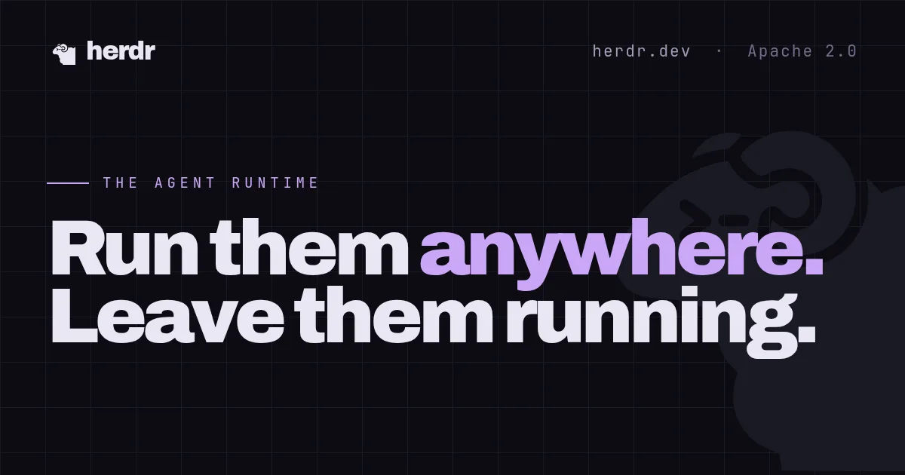
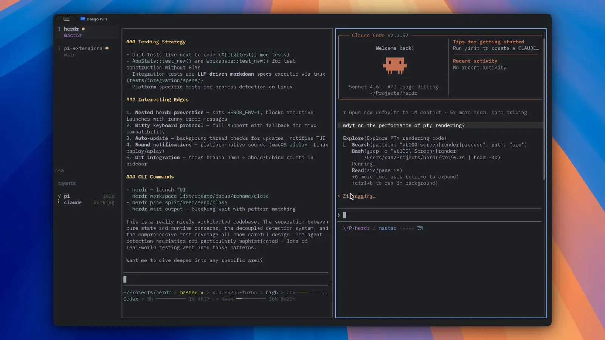

# Herdr：给 Coding Agent 用的终端运行时

**一句话定位：** Herdr 是 Coding Agent 住的那一层运行时。它是一个 Rust 二进制，画在你已经在用的终端里，而不是另一套 Electron 应用。Claude Code、Codex、Cursor、OpenCode、Grok 以及其他 CLI Agent 原样启动，Herdr 只拥有它们所在的终端：客户端关掉或 SSH 断了，后台服务里的窗格还在跑。

协议是 Apache 2.0。仓库是 [herdrdev/herdr](https://github.com/herdrdev/herdr)。




---

## 一、它解决什么问题

同时开几个 Agent 时，真正麻烦的通常不是再开一个标签，而是这三件事：

1. 合上笔记本、断掉 SSH，或者关掉终端窗口之后，Agent 还在不在。
2. 哪个窗格在干活，哪个停下来等你点 Yes。
3. 另一个 Agent 或一段脚本能不能可靠地开窗格、读输出、等到对方真的卡住，而不是对着屏幕狂按回车。

Herdr 把这三件事做成会话服务器的能力。你在窗格里照旧输入 `claude`、`codex`、`opencode` 或 `grok`。它不包一层自己的 Agent，也不替换这些 CLI 的登录和计费。

层级从大到小是：

| 层级 | 是什么 |
|---|---|
| **Session** | 一个后台 Herdr 服务器。默认的 `herdr` 连默认会话；命名会话各自有窗格、socket 和运行时状态，共用同一份全局配置。 |
| **Workspace** | 一个项目容器。侧边栏上的状态从里面的 Agent 往上汇总。一个仓库或一件事放一个 workspace。 |
| **Tab** | workspace 里的一套布局，例如 agents、logs、server。CLI 和 socket 都能按 id 找到它。 |
| **Pane** | 一个真实终端。服务端持有 PTY 和进程，客户端只负责画和把按键送回去。 |
| **Agent** | Herdr 在某个窗格里认出来的前台进程。认不出来的程序仍然是普通终端。 |

先用 workspace 把项目分开。只有需要完全独立的进程和 socket 时，再开命名会话。

---

## 二、原理：客户端、服务端、脱离

Herdr 默认是「一个后台服务器 + 若干个终端客户端」。

- **服务器**拥有窗格、PTY、进程和会话状态。
- **客户端**是你眼前的 TUI。它附着、脱离、把屏幕画出来。
- 多个客户端可以看不同的 workspace 和 tab。看同一个 tab 时，最后一次聚焦或操作的那个客户端决定窗格尺寸。

本地启动时不用自己管 socket。在项目目录执行 `herdr`，它会连上已有的默认会话，没有就拉起一个。

脱离客户端：

```bash
# 前缀默认是 ctrl+b，然后按 q
# 也可以直接关掉终端窗口
```

窗格、shell、Agent、测试和开发服务器都留在服务端。Linux 和 macOS 上这个服务端会忽略 `SIGHUP`，所以启动它的那个 shell 挂断不会把窗格一起带走。要停掉，用 `herdr server stop` 或 `SIGTERM`。`herdr server stop` 会结束这个会话以及里面的窗格进程。

再连回来就是再执行一次 `herdr`。

这和「进程还活着」不是同一件事。官方把几条状态路径分得很清楚：

| 情况 | 原进程还在 | 布局回来 | 刚才的屏幕 | Agent 对话 |
|---|---|---|---|---|
| 脱离后再连上 | 在 | 在 | 在，来自活着的终端 | 在，因为进程没停 |
| 服务端停掉再启动 | 不在 | 在 | 只有打开了窗格屏幕历史才有 | 只有原生会话恢复能拉回来 |
| 更新且不用 `--handoff` | 兼容的服务器继续跑；必须重启的那次会停进程 | 重启后布局在 | 同上，靠屏幕历史 | 同上，靠原生会话恢复 |
| 更新或远程附着带 `--handoff` | 对支持的服务器是尽力而为 | 在 | 移交成功则来自活终端 | 移交成功则进程还在 |

所以：合盖、关客户端、SSH 掉线，Agent 继续跑。整台机器重启，或者你执行了 `herdr server stop`，**原来的进程不会活过来**。Herdr 恢复的是保存下来的会话形状：workspace、tab、窗格、工作目录、布局和焦点。不能走更强恢复路径的窗格，会在原来的目录里变成一个新 shell。目录不存在或 shell 起不来时，窗格留在布局里并显示错误，不会悄悄挪到家目录。

另外两条可选恢复：

- **窗格屏幕历史**默认关闭。输出里可能有密钥和提示词。在配置里打开 `[experimental] pane_history = true` 之后，重启才会把最近的屏幕内容重放到 `session-history.json`。它不恢复旧进程，而且只在布局和保存时完全一致时重放。
- **原生 Agent 会话恢复**默认开启。集成上报过会话引用，或者 Agent 自己上报过恢复命令时，服务端重启后会用官方恢复命令把那个 Agent 拉回来，例如 Claude Code 的 `claude --resume`、Codex 的 `codex resume`、Cursor Agent CLI 的 `cursor-agent --resume`、OpenCode 的 `opencode --session`、Grok CLI 的 `grok --resume`。不支持、过期或重复的引用会退回普通 shell。用 `herdr integration status` 看集成版本，过旧就执行 `herdr integration install`，后面跟上集成名，例如 `claude`。关掉这一行为：`[session] resume_agents_on_restore = false`。

**Live handoff** 是另一条路，而且是实验性的、要显式打开。`herdr update --handoff` 或 `herdr --remote workbox --handoff` 会请旧服务器把活着的 PTY 交给新服务器，成功的话进程可以跨过这次替换。进行中的 CLI 请求、等待和订阅可能被打断，客户端要重连重试。Homebrew、mise、Nix 安装不走 `herdr update`，因此也不能靠这条命令做移交。普通的 `herdr update` 会装新客户端，并让已经兼容的服务器继续跑，不会为了版本号差一位就杀掉窗格。

---

## 三、原理：窗格状态从哪来

侧边栏上的状态不是装饰。官方定义是：

| 状态 | 含义 |
|---|---|
| `blocked` | 需要输入、批准或做决定。检测故意很严：只有窗格最底部的实时画面匹配已知的批准、提问或权限界面才标这个。 |
| `working` | 正在跑。 |
| `done` | 已经结束，而这个客户端还没看过。 |
| `idle` | 已经结束或在等，并且已经被看过。CLI / API 里的 `idle` 和 `done` 都表示可以再输入；每个客户端各自记自己看过没有，所以徽章可以和另一个客户端或 CLI 不一致。 |
| `unknown` | 认得出是 Agent，但分不了类。它不表示任务成功。 |

往上汇总的规则很直接：有一个 blocked，窗格、tab、workspace 都显示 blocked；有 working，workspace 看起来还在忙；done 会一直留着，直到你看过。

状态有两条来源：

1. **Herdr 自己认。** 它找窗格里的前台进程，读窗格最底下正在画的那一块（不是你滚上去的历史），用检测清单判断 idle / working / blocked。集成如果也在上报，就改用上报，不再读屏幕。
2. **Agent 自己报。** 进程在 Herdr 窗格里会继承 `HERDR_ENV=1`、`HERDR_PANE_ID`、`HERDR_BIN_PATH`、`HERDR_SOCKET_PATH`，以及 workspace / tab / pane id。Agent 只在这些变量都在时上报。状态用 `idle`、`working`、`blocked`；`--seq` 必须递增，迟到的报告会被丢掉。

```bash
"$HERDR_BIN_PATH" pane report-agent "$HERDR_PANE_ID" \
  --source my-agent \
  --agent my-agent \
  --state working \
  --seq 1
```

`--source` 不要用 `herdr:` 前缀，那是官方集成的命名空间。恢复命令要另报，退出时要 release，这样重启后同一个窗格才能回到同一次会话。

两件容易误用的事：

- 已知 Agent 没有匹配到规则时，会退回 `idle`，解释输出里的原因是 `default_known_agent_idle_fallback`。新的提问界面可能暂时被看成 idle。**idle 不是批准那次操作的许可。** 自动化如果看见 idle 就往里打字，可能打进批准对话框。先 `herdr agent explain` 或读窗格。
- 沙箱或 VM 套壳会挡住宿主机看到的前台进程。在套壳命令上设置 `HERDR_AGENT=claude` 这类提示，告诉 Herdr 用哪一份屏幕清单。提示必须出现在宿主机看得到的那个进程上，只写在容器里面无效。

Amp、Kiro、Gemini CLI、Cline 等是「只读屏幕状态」。Claude Code、Codex、Cursor Agent CLI、OpenCode、Grok、Copilot CLI 等还有可安装的集成，用来在服务端重启后恢复会话。Command Code、Crush 这类则自己向 Herdr 报状态，不用再装集成。认不出来的 CLI 照样能跑，只是侧边栏里它就是一个普通终端。

---

## 四、原理：换行分隔的 JSON socket

自动化有三层，表面是同一套控制能力：

| 层 | 适合 |
|---|---|
| Agent skill | 教窗格里的 Agent 怎么用 Herdr |
| CLI | 脚本、简单编排、人来排查 |
| 原始 socket | 自己的客户端，或要长期订阅事件 |

socket 上是 **newline-delimited JSON**。Unix 是域套接字，Windows 是命名管道。一行一个请求：

```json
{"id":"req_1","method":"ping","params":{}}
```

成功时原样带回 `id`：

```json
{"id":"req_1","result":{"type":"pong"}}
```

默认套接字在 `~/.config/herdr/herdr.sock`。命名会话在 `~/.config/herdr/sessions/` 下各自的目录里，文件名同样是 `herdr.sock`。解析顺序是：CLI 的 `--session`，然后 `HERDR_SOCKET_PATH`，然后 `HERDR_SESSION`，最后才是默认会话。插件和脚本优先调用 `HERDR_BIN_PATH`，这样 Unix 套接字和 Windows 命名管道都不用自己适配。

能控制的范围包括 workspace、tab、窗格的拆分和输入、Agent 的列出、读取、prompt 和等待、事件订阅、集成安装，以及停服务器、重载配置。当前二进制自带的协议用这个看，不要凭记忆写方法名：

```bash
herdr api schema
herdr api schema --json
```

`herdr api snapshot` 打印一次 `session.snapshot`，适合客户端做启动快照。它不是订阅。事件会作废本地缓存；订阅跟丢时服务器发 `events_lost` 并关掉这条连接，正确做法是重新订阅，再用 snapshot 和权威读取对账。

和「对着终端打字」不同的几个行为：

- `agent start` 只在已经存在的 shell 窗格里启动 Agent，不负责拆布局。它要等到检测认为这个 Agent 可以交互才返回。启动过程中如果已经是 `blocked`，返回 `agent_not_ready`。
- `agent prompt` 在对方已经 `blocked` 时返回 `agent_blocked`，不发送输入，也不开始等待。批准框要用 `agent send-keys` 有意识地回答。
- `agent wait` 钉住当前这个窗格占用者。中途换成另一个进程，不能拿来凑这次等待。
- 窗格 id（如 `w1:p1`）和 Agent 别名（如 `reviewer`）都只在这一台服务器里有效。UI 里切到另一台机器，不会把你当前 shell 里的 CLI 重定向过去。

创建命令直接打印 JSON。用返回值里的 id，不要猜：

```bash
created=$(herdr workspace create --cwd ~/project --label api --no-focus)
pane_id=$(printf '%s\n' "$created" | jq -r '.result.root_pane.pane_id')

split=$(herdr pane split "$pane_id" --direction right --no-focus)
review_pane=$(printf '%s\n' "$split" | jq -r '.result.pane.pane_id')

herdr agent start reviewer --kind codex --pane "$review_pane" -- -m gpt-5.4
herdr agent prompt reviewer "Review the current diff" --wait --timeout 120000
herdr agent read reviewer --source recent-unwrapped --lines 120
```

`--kind` 后面的可执行文件和参数以当前版本文档为准。等待命令默认没有超时。超时或服务器错误时，CLI 把 JSON 错误打到 stderr，退出码 1。

---

## 五、安装

Linux 和 macOS：

```bash
curl -fsSL https://herdr.dev/install.sh | sh
```

Windows：

```powershell
powershell -ExecutionPolicy Bypass -c "irm https://herdr.dev/install.ps1 | iex"
```

终端安全策略拦住无文件的 PowerShell 时，官方给的是先落下安装脚本再执行：

```bat
curl.exe -fsSLo install.cmd https://herdr.dev/install.cmd && install.cmd && del install.cmd
```

已经在用包管理器的话：

```bash
brew install herdr
mise use -g herdr
```

`mise` 提示 registry 里没有 herdr 时，先更新 mise。临时也可以 `mise use -g github:herdrdev/herdr`。Nix 用发布标签，把 `v0.x.y` 换成 [GitHub Releases](https://github.com/herdrdev/herdr/releases) 上的版本：

```bash
nix profile install github:herdrdev/herdr/v0.x.y
```

也可以从 Releases 下对应平台的二进制。Windows 的 zip 里除了 `herdr.exe` 还有它自带的 ConPTY 运行时，整个目录要留在一起。

装好后在项目目录执行 `herdr`。shell 找不到命令时，重开终端或检查安装目录是否在 `PATH` 上。

Herdr 自己的安装器用 `herdr update` 更新，也可以 `herdr channel set preview` / `herdr channel set stable` 换通道。Homebrew、mise、Nix 的安装用各自的包管理器更新，不要对它们跑 `herdr update`。

---

## 六、基本用法

在仓库目录里：

```bash
herdr
```

会话还没有 workspace 时会自动开一个。在窗格里启动 Agent：

```bash
claude
# 或者 codex、opencode、grok、cursor-agent，以及其他它能认的 CLI
```

鼠标是一等公民：点窗格、tab、workspace 和 Agent，拖分割条，右键菜单里拆分和新建 tab。拖选文字会复制，不需要 Ctrl+C。键盘是可选层。前缀默认 `ctrl+b`，在 Herdr 里按 `prefix+?` 看当前全部绑定。

| 动作 | 键 |
|---|---|
| 向右拆分 | `prefix+v` |
| 向下拆分 | `prefix+-` |
| 新 tab | `prefix+c` |
| 下一个 / 上一个 tab | `prefix+n` / `prefix+p` |
| workspace 导航 | `prefix+w` |
| 新 workspace | `prefix+shift+n` |
| 脱离客户端 | `prefix+q` |
| 复制模式 | `prefix+[` |

要发给窗格一个真正的 `ctrl+b`，按两次 `ctrl+b`。不想让 Herdr 吃掉鼠标时，配置里设 `ui.mouse_capture = false`。这也会关掉点击 tab 和拖分割条。

结束整个会话：

```bash
herdr server stop
```

独立的一组窗格用命名会话：

```bash
herdr session list
herdr session attach work
herdr session stop work
herdr session delete side-project
```

删除时名字要和 `session list` 完全一致，包括大小写。




官方仓库里的这张界面展示了侧边栏状态（例如 idle、working）以及同一会话里并排的 Agent 窗格。具体配色和版本会随发布变化。

---

## 七、多机、直接附着和插件

有三条远程路径，选错会以为「进程丢了」：

| 路径 | 怎么用 | 进程在哪 |
|---|---|---|
| 普通 SSH | `ssh you@server` 然后 `herdr` | 全在远程。手机 SSH 客户端也走这条。脱离后重新 SSH，再执行 `herdr`。 |
| 本地 UI 挂一台 | `herdr --remote workbox` 或 `herdr --remote ssh://you@server:2222` | 窗格在远程服务器，界面用本机主题和键位来画。本机剪贴板里的图片可以桥过去。 |
| 一个窗口里多台 | `herdr machine add workbox` | 每台机器自己的 Herdr 服务器和进程。断一台不影响其他台。从侧边栏拿掉这台机器只断开客户端，不停止那边的会话。 |

先确认普通 SSH 能登录。交互终端里添加机器，这样需要安装或替换远程二进制时 Herdr 会先问你，默认答案是不停止正在跑的服务器：

```bash
ssh workbox
herdr machine add workbox
herdr machine add workbox --label "Build machine"
herdr machine add workbox --remote-session agents
herdr machine list
```

脚本要操作某一台已保存机器上的 Agent 时，加上 `--machine` 和 `herdr machine list` 里的配置名，例如 `herdr --machine workbox agent list`。不带这个前缀的命令仍走当前窗格继承到的那一个 socket。

只想把当前终端接到某一个 Agent，而不是整块 UI（Linux 和 macOS，原生 Windows 没有这条）：

```bash
herdr agent attach reviewer
herdr terminal attach term_abc123
herdr terminal attach term_abc123 --takeover
```

脱离仍是 `ctrl+b q`。第三方只要画面、不要输入权时，用 `herdr terminal session observe`；要读写则用 `herdr terminal session control`。两者都是换行分隔的 JSON 帧。

插件是带 `herdr-plugin.toml` 的可执行包，语言不限。Herdr 负责安装、校验清单、键位、事件和把 CLI / socket 交给插件；插件没有单独的窄 SDK，**整个 CLI 就是插件 API**。动作、事件钩子和插件窗格都在清单里声明，v1 不能在运行时再注册动作。装好的插件记在会话旁边的 `plugins.json` 里，重启还在。键位可以绑到 `plugin_action`。

---

## 八、和 Agent 一起用

日常就是在窗格里启动你已经付费的 CLI。需要脚本协调时，用 Agent 命令处理生命周期，用窗格命令处理普通进程：

```bash
herdr agent wait reviewer --until blocked --timeout 120000
herdr agent read reviewer --source recent-unwrapped --lines 80
herdr agent send-keys reviewer esc

herdr pane run w1:p3 "just test --watch"
herdr pane wait-output w1:p3 --regex "passed|failed" --timeout 120000
```

给窗格里的 Agent 起一个稳定别名：

```bash
herdr agent rename w1:p1 reviewer
herdr agent rename reviewer --clear
```

别名匹配 `[a-z][a-z0-9_-]{0,31}`，只在这个 Agent 还占着窗格时有效。

Herdr 也有 `worktree.list` / `create` / `open` / `remove`，可以把 git checkout 打开成 workspace。`worktree.remove` 对链接出来的子工作区执行 `git worktree remove`，**不会删除分支**。它不是下面那篇 Orca 那种「每个任务默认一个 worktree，再带编辑器、diff 和浏览器」的环境。

完整方法列表以 [Socket API](https://herdr.dev/docs/socket-api/) 和 `herdr api schema` 为准。给自己的 Agent 加上报，看 [Add Herdr support](https://herdr.dev/docs/add-herdr-support/)。

---

## 九、和 tmux、cmux 怎么放

| | Herdr | tmux | cmux |
|---|---|---|---|
| 形态 | 现有终端里的 Rust TUI，加一个后台服务器 | 终端里的复用器 | macOS 原生 GUI 终端 |
| 脱离后进程 | 客户端脱离或 SSH 断开后，服务器里的进程继续 | 会话还在则进程继续 | 退出应用后不恢复实时进程 |
| 服务器或机器重启 | 布局恢复；原进程不在；支持的 Agent 可以按官方 resume 命令回来 | 默认进程也没了 | 恢复窗口布局和元数据，不恢复进程 |
| Agent 状态 | working / blocked / done / idle，可等待 | 没有 | 通知环，靠终端 OSC 或 CLI |
| 多机 | 一个窗口里挂多台 SSH，各有自己的服务器 | 每台自己连 | 本机应用 |
| 内置浏览器 | 没有 | 没有 | 有，并且可编程 |
| 平台 | Linux、macOS、Windows | 很广 | 仅 macOS 14+ |
| 前缀 | 默认 `ctrl+b`，鼠标可以不用前缀 | 默认 `ctrl+b` | GUI 快捷键 |

已经在 tmux 里生活、只需要会话还在，tmux 足够。要在 macOS 上要垂直工作区、通知环和内置浏览器，用 [cmux](./cmux.md)。要让多个现有 Agent CLI 在脱离后继续跑，并且脚本能等到它们真的 blocked，用 Herdr。

Herdr 可以跑在 tmux 里面，但不要让 shell 在 Herdr 窗格里再自动进入 tmux，否则检测看到的前台进程是 tmux 本身。官方建议的启动条件是：`TMUX` 为空，并且 `HERDR_ENV` 不是 `1`。

---

## 十、写在最后

Herdr 值得记住的分界只有一条：脱离客户端时，窗格里的进程还在；停掉服务器或整机重启时，回来的是布局，原进程需要原生会话恢复或你自己再启动。状态用来决定你去看哪一个窗格，不要把 idle 当成可以自动批准的信号。

官网：https://herdr.dev  
文档：https://herdr.dev/docs/  
GitHub：https://github.com/herdrdev/herdr

---

## 相关工具

如果多个 Claude Code、Codex 或其他终端 Agent 开始抢账号和额度，可以了解一下 [EbeeAI](https://ebeeai.net)。它提供统一的 AI API 接入和用量管理，新用户注册后有 $10 试用额度，适合先用小规模 Agent 任务看成本和稳定性。Herdr 本身不代理这些模型的订阅。
