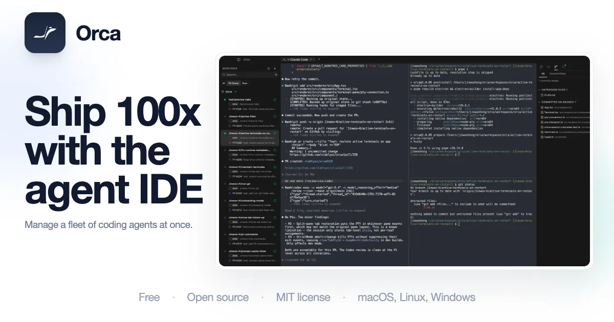
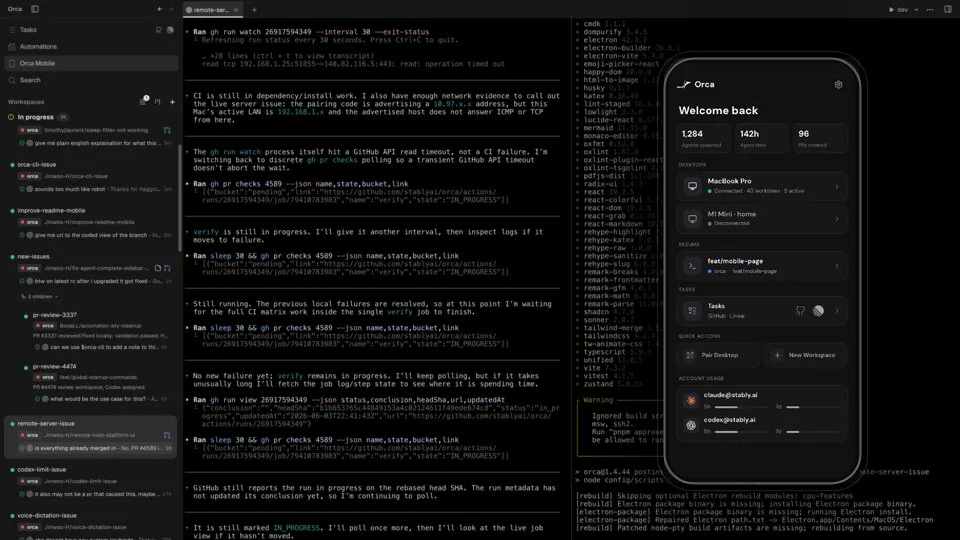
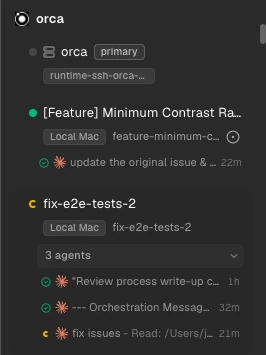
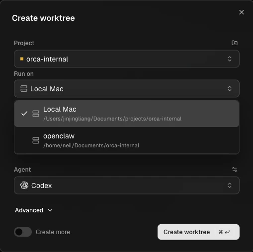
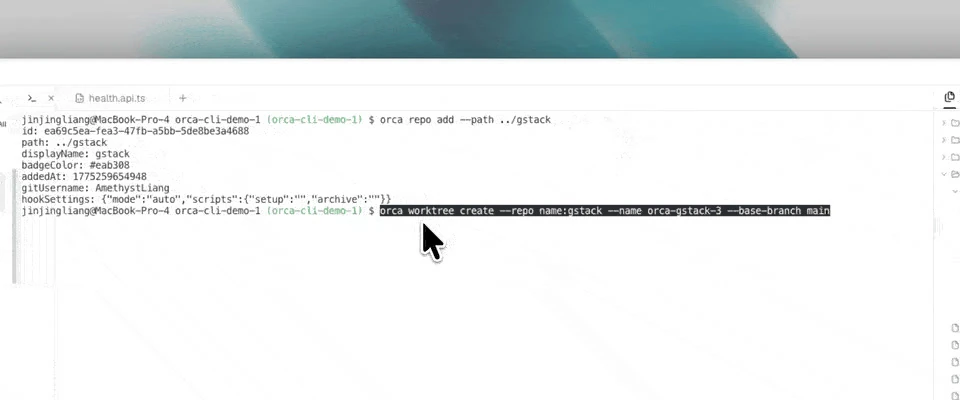
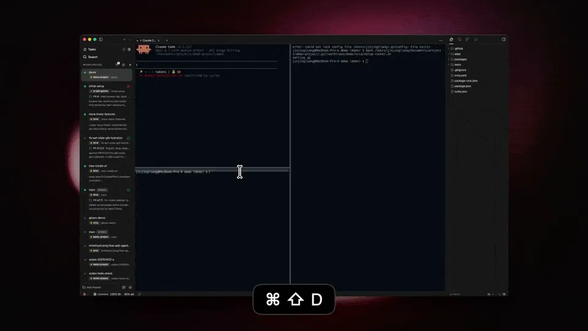
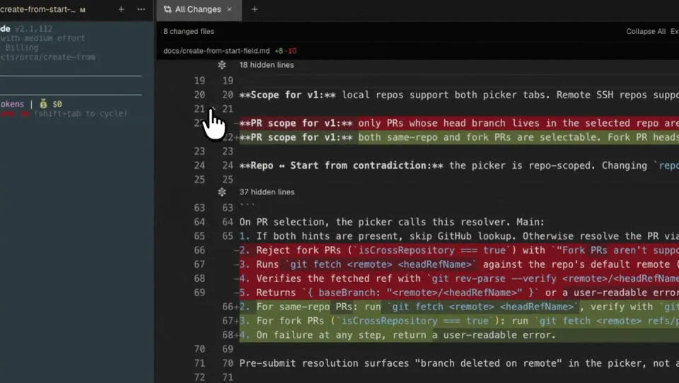
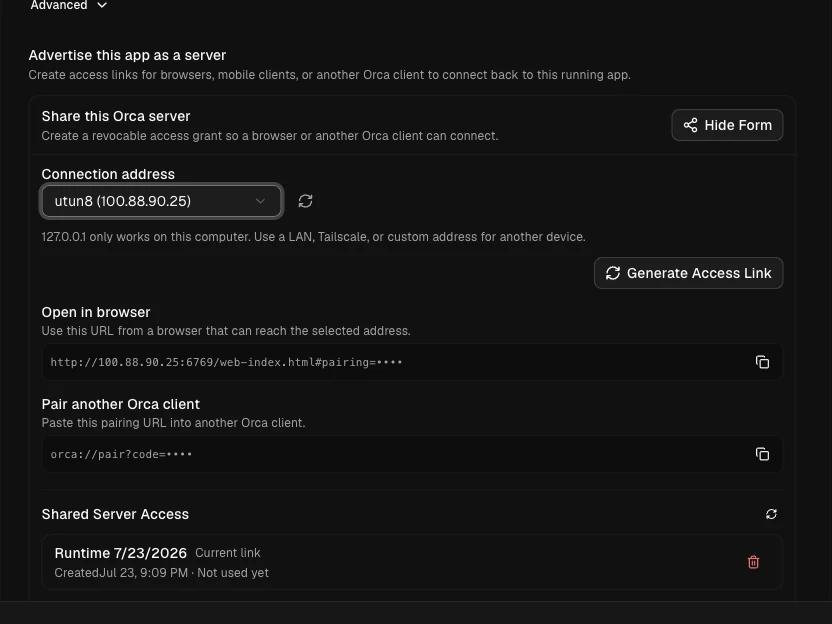
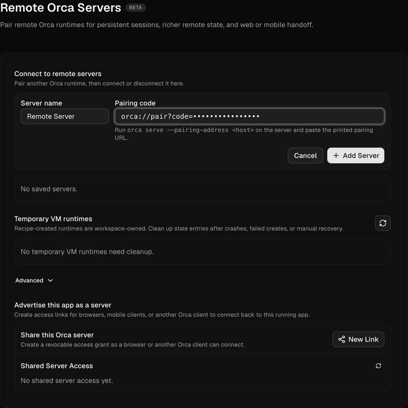
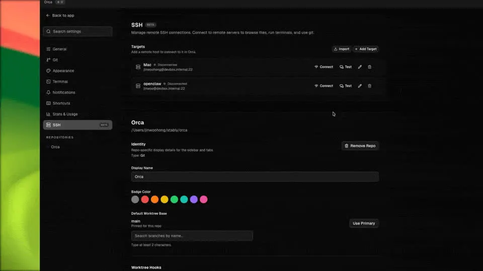

# Orca：每个任务一个 git worktree 的 Agent 开发环境

**一句话定位：** Orca 是面向人和 Agent 一起干活的开发环境（官方叫 ADE）。每个任务是一份真实的 `git worktree`：自己的目录、自己的分支、自己的 Agent 终端。你可以同时跑 Claude Code、Codex、OpenCode、Grok、Cursor 以及其他 CLI Agent，用的是你自己的订阅。Orca 不提供模型。

桌面端覆盖 macOS、Windows、Linux，另有 iOS / Android 配套。协议是 MIT。仓库是 [stablyai/orca](https://github.com/stablyai/orca)。官网是 [onorca.dev](https://www.onorca.dev)，仓库主页也指向 [orca.dev](https://orca.dev)。

认准这个仓库。它不是 VirtusLab 的 Orca，也不是别的 `orca-cli`。Linux 上随应用发布的命令名叫 `orca-ide`，用来避开 GNOME 的 Orca 屏幕阅读器。




---

## 一、它在工作流里站哪一层

编辑器默认假设只有一个人在同一份检出上打字。终端复用器假设进程要活着，但默认还是同一份工作区。Orca 把「一件事」做成隔离单位：

1. 从基线引用拉出一份 `git worktree`。
2. 在这份检出里启动 Agent、终端、编辑器标签和浏览器标签。
3. 对照起始引用看 diff，把行注释送回 Agent，再在应用里提交、推送、开 PR。
4. 归档或删除时，连目录和分支一起收掉（删除前会确认）。

官方把运行位置分成四种。Orca 不卖托管 VPS，远程机器和云账号都是你自己的：

| 模式 | 文件和 Agent 在哪 | 适合 |
|---|---|---|
| 本地 | 这台桌面电脑 | 日常改代码 |
| SSH worktree | 你用 SSH 连上的那台主机 | 编译机、GPU、常开的 VPS。编辑器和 diff 仍在笔记本上 |
| Remote Orca Server | 另一台跑着 Orca 桌面或 `orca serve` 的机器 | 笔记本休眠后任务还要继续；手机、网页和自动化共用同一运行时 |
| 按工作区的云 VM | 你的云账号上的一次性环境 | 用完即弃的隔离计算 |

SSH 和 Remote Orca Server 的差别在于谁拥有运行时。SSH 时，笔记本上的 Orca 驱动远程主机上的 `git worktree` 和 Agent，断线后远程进程还在，笔记本再连上。Remote Orca Server 时，项目、worktree、终端和 Agent 进程都属于那台服务器，客户端只是界面。想让任务熬过笔记本休眠，用后面这条，而不是指望本地桌面进程自己活着。

---

## 二、原理：worktree 为什么能并行

Orca 以 worktree 为原生单位。并行安全来自文件系统，而不是「请 Agent 别改同一个文件」。

- 每个仓库有一个基线引用，通常是 `origin/main`。
- 每个 worktree 有自己的起始引用、分支、磁盘目录和 Agent 终端。
- 删除 worktree 会去掉目录和分支，并且先确认。git 若因为还有未合并提交而留下本地分支，Orca 可以再给你一次审查，而不是偷偷强制删除。
- 你在终端里照常用 `git status`、`git rebase`。Orca 下次渲染会看到这些变化。自己用 `git worktree add` 做出来的检出，要在侧边栏里手动显示之后才进入 Orca。

创建对话框提交后会马上关掉。`git fetch` 和 `git worktree add` 在后台继续，侧边栏出现进度行。你可以切去别的 worktree，完成后它不会把你拽回来。失败时面板上有错误和重试。

起始引用可以是仓库基线、另一条本地分支、某个提交，或一条远程分支。从 GitHub PR、Linear、Jira、GitLab 建出来时，分支名跟那张工单走，避免和手填的分支名打架。侧边栏里的父子关系只影响 Orca 怎么分组，不改 git 历史。

新 worktree 是干净检出。`node_modules`、缓存和 `.env` 这些被 git 忽略的路径不会跟着来。Orca 用三种互补办法补上：

| 办法 | 行为 |
|---|---|
| 设置里该仓库的 Worktree Shared Paths | 从主检出物化到新 worktree。macOS 上优先 APFS 克隆，否则符号链接。 |
| 仓库根目录 `orca.yaml` 的 `worktree.sharedDirectories` | 签进仓库的共享目录列表，符号链接，不复制。适合 `node_modules`、`.cache`。路径必须是主检出里已有的、被忽略的目录。 |
| 仓库根目录 `.worktreeinclude` | 把列出的被忽略文件**复制**进每个新 worktree，各持一份。适合 `.env`。只支持字面路径，glob 和取反会被跳过并警告。 |

```yaml
# orca.yaml
worktree:
  sharedDirectories:
    - node_modules
    - .cache
```

```text
# .worktreeinclude
.env
.env.local
.vscode/settings.json
```

`orca.yaml` 是在个人设置的共享路径之上追加，不会替换它。已经共享过的路径不会再被 `.worktreeinclude` 复制一遍。

---

## 三、原理：编排层在管什么

一个 Agent 终端就够时，用 `orca terminal send` 把提示送进去。需要所有权、完成回执或一张任务依赖图时，用编排。编排在 **Settings → Experimental** 里打开，而且 CLI 得先能连上正在运行的 Orca（`orca status --json` 成功）。

官方模型是这些对象，Run 自己不调度、也不放置 worker：

| 对象 | 作用 |
|---|---|
| **Run** | 持久的名字空间和协调者收件箱。 |
| **Task** | 一件工作。状态包括 `pending`、`ready`、`dispatched`、`completed`、`failed`、`blocked`。 |
| **Dispatch** | 某次把任务放到一个终端上的尝试。`worker_done` 和心跳以它为准。 |
| **Message** | 收件箱里的信：状态、派发、完成、升级、提问、心跳。 |
| **Decision gate** | 协调者提出的问题。没解决之前，对应任务停住。 |

完成权在当前这次 dispatch 上。worker 上报完成或心跳时要同时带上 task id 和 dispatch id，避免过期重试把另一次尝试标完成。

推荐的受监督回路是创建 Run、创建任务、再启动 worker。旧的 `orca orchestration run`、`run-stop` 以及 coordinator 的 start/stop **不再产生效果**，只会返回一段恢复说明，指向 `orca skills get orchestration --full`。

```bash
orca orchestration run-create --objective "Split checkout QA and summarize blockers" --json
orca orchestration task-create --spec "Audit billing settings for mobile layout" --task-title "Billing audit" --json
orca orchestration worker-start --task <taskId> --worktree current --agent codex --json
```

要新开子 worktree：

```bash
orca orchestration worker-start --task <taskId> --worktree new-child --name billing-audit --agent codex --setup run --json
```

worker 结束时从自己的窗格上报，而且只能上报一次，失败也要报。`--outcome` 只能是 `succeeded` 或 `failed`：

```bash
orca orchestration send \
  --type worker_done \
  --subject "Completed mobile audit" \
  --body "Fixed footer overlap; no follow-ups." \
  --task-id <taskId> \
  --dispatch-id <dispatchId> \
  --outcome succeeded \
  --json
```

协调者侧等待完成、升级或提问：

```bash
orca orchestration check --wait --types worker_done,escalation,question --timeout-ms 900000 --json
```

worker 不要在本地 TUI 里干等用户。阻塞问题走 `orca orchestration ask`，这样协调者能做成决策门。旗标会随应用变。装好之后让 Agent 读当前全文，而不是背这篇笔记：

```bash
orca skills get orchestration --full
```

---

## 四、原理：CLI 怎样驱动这套环境

`orca` 跟的是**正在运行的 Orca 运行时**，不是一个单独的无头 git 工具。脚本和 Agent 用它查看 worktree、开终端、打开文件、操作内置浏览器，以及把进度写回 Orca。

命令随桌面应用发布。官方 CLI 概览写的注册位置是 **Settings → General → Orca CLI**；CLI 参考里也出现过 **Settings → Experimental → CLI**。以你这一个版本的设置页为准。Orca 会把自己的 `orca` 放在终端 `PATH` 的前面，避免打到一个更旧的全局安装。Linux 上对应的名字是 `orca-ide`。

```bash
command -v orca
orca status --json
```

还没启动应用时：

```bash
orca open --json
orca status --json
```

给人看的输出不带 `--json`。交给另一个程序时加上 `--json`。

多数命令用选择器，而不是逼你记长 id。`active` 和 `current` 从当前目录或当前终端解析到包住它们的那份 Orca worktree。脚本可能跑在目标目录外面时，写明确的 `id:`、`path:`、`branch:` 或 `issue:`。远程运行时优先用服务器那一侧的完整选择器，因为你笔记本上的当前目录在那台主机上可能不存在。

```bash
orca host list --json
orca worktree list --repo id:<repoId> --json
orca worktree show --worktree active --json
orca worktree show --worktree path:/abs/path/to/worktree --json
orca worktree show --worktree branch:feature-name --json
```

内置浏览器也由同一套 CLI 驱动，对象是这个 worktree 里的 Orca 浏览器标签，不是系统 Chrome。循环是快照、操作、再快照。`@e3` 这种引用只对刚刚那次 `snapshot` 有效，导航或页面变了就要重新快照：

```bash
orca goto --url http://localhost:3000 --worktree active --json
orca snapshot --worktree active --json
orca click --element @e3 --worktree active --json
orca fill --element @e1 --value "user@example.com" --worktree active --json
orca wait --text "Welcome" --worktree active --json
orca screenshot --worktree active --json
```

Agent 可以装与当前应用匹配的 skill，避免把过期旗标写进提示词：

```bash
npx skills add https://github.com/stablyai/orca --skill orca-cli
orca skills install --skill orca-cli
```

---

## 五、安装

桌面应用：

- macOS：Apple Silicon 与 Intel 安装包，或 Homebrew
- Windows：安装包。默认 shell 在 Settings → Terminal 里选 PowerShell 或 CMD
- Linux：要自动更新用 AppImage。`.deb` 和 `.rpm` 会提示可用更新以及对应的包管理器命令，执行前先退出 Orca
- 旧版本在 GitHub Releases

```bash
brew install --cask stablyai/orca/orca
```

`brew upgrade --cask orca` 跟稳定通道。RC 用 Releases，或在应用里对 Check for Updates 按住 Shift 再点。Arch 可以用 `yay -S stably-orca-bin`。

下载页：https://onorca.dev/download  
最新构建也挂在 [GitHub Releases](https://github.com/stablyai/orca/releases/latest)。

第一次打开会要家目录权限以便添加仓库，并提议导入已有的 `~/.claude`、`~/.codex` 和 Ghostty 终端设置，然后停在空的落地页。macOS 包有签名和公证；官方说明它基于 Electron，首次打开时系统仍可能要求确认。

手机端是配套，不是另一套独立 IDE：

- iOS：[App Store 上的 Orca IDE](https://apps.apple.com/us/app/orca-ide/id6766130217)
- Android： [onorca.dev 的 APK](https://www.onorca.dev/download/android)，安装说明在文档的 Android APK 页

它用来看 Agent 状态、用量、切换账号，以及人离开桌子之后继续给终端发下一步。




---

## 六、基本用法

### 在界面里开一个任务

1. 添加仓库。
2. 新建 workspace：任务名、从哪条引用拉分支、可选的 GitHub / Linear / Jira / GitLab 链接、要启动的 Agent。选空白终端就只给一个普通 shell。
3. Agent、编辑器、浏览器和终端都落在这份 worktree 里。
4. 用相对起始引用的 diff 做审查。Annotate AI Diff 可以把某一行的评论送回 Agent。
5. 在应用里提交、推送、开 PR，看检查结果。
6. 归档，或删除。删除会收掉 worktree 目录和分支。

Run on 用来选这件工作跑在本机、某台 SSH 主机，还是一台已配对的服务器。主机还没为这个项目准备好检出时，可以在创建表单里指定项目位置，不必先退出对话框。




官方文档里的侧边栏：每条 worktree 标明跑在本机还是 SSH 主机上，展开后能看到同一个任务里并行的多个 Agent。



创建对话框里选仓库、Run on（本机或已保存的 SSH 主机）和要启动的 Agent。


### 用 CLI 做同样的事

先列出或确认仓库 id，再创建。在一份 Orca worktree 里面执行 `worktree create` 时，Orca 能推断的话会把新 worktree 记成子节点。要明确关系就加 `--parent-worktree active`，彼此无关就加 `--no-parent`。

```bash
orca worktree ps --json
orca worktree create --repo id:<repoId> --name fix-login --json
orca worktree create --repo id:<repoId> --name my-task --issue 123 --json
orca worktree create --name review-api --agent claude --setup run --json
orca worktree create --name quick-check --agent codex --prompt "Summarize the diff" --setup skip --json
orca worktree set --worktree active --comment "reproduced failure; testing token refresh fix" --json
orca worktree rm --worktree id:<worktreeId> --force --json
```

`--setup` 取 `run`、`skip` 或 `inherit`。`inherit` 跟随仓库策略。`--prompt` 会把第一段工作直接送给刚启动的那个 Agent。




官方 CLI 演示：先 `orca repo add` 把仓库登记进正在运行的 Orca，再 `orca worktree create` 指定仓库名、任务名和基线分支。


已有 workspace 里再启动一个 Agent：

```bash
orca agent launch --agent codex --json
orca agent launch --agent claude --worktree path:/projects/myapp --focus --json
```

Chat UI 打开、并且这个 Agent 和主机支持时，启动结果是结构化对话；否则是一个终端。返回值里的 `outcome.kind` 说明打开的是哪一种。`--model` 接受提供商自己的模型 id，只对这一次启动生效，不要自己编一个名字。

终端：

```bash
orca terminal list --json
orca terminal read --json
orca terminal send --text "continue" --enter --json
orca terminal wait --for tui-idle --timeout-ms 30000 --json
orca terminal create --worktree path:/projects/app --command "npm test" --json
orca terminal split --direction vertical --command "npm run dev" --json
```




这张图来自官方 README 的终端分屏演示：左侧是按 workspace 列出来的任务，中间是可以再拆的终端。

---

## 七、浏览器、diff 和远程

内置浏览器是一块嵌在工作区里的 Chromium。Design Mode 里点中页面上的元素，可以把 HTML、CSS 和裁切后的截图送进 Agent 的提示。响应式检查用设备配置：

```bash
orca set device --name "iPhone 12" --worktree active --json
orca screenshot --worktree active --json
```

审查时，diff 相对的是这份 worktree 的起始引用。行上的评论走 Annotate AI Diff，回到正在改这些文件的 Agent。提交和 PR 留在同一个工作区里完成。




### SSH worktree

1. Settings → SSH → Add Target。填写主机、用户、端口和可选的私钥，或从 `~/.ssh/config` 选一台。
2. Test，再 Save。带口令的密钥会在第一次使用时询问。
3. 创建 worktree 时，Run on 选这台主机。

Orca 在远程创建 `git worktree`，Agent 经 SSH 跑在那台机器上，文件事件同步回本机，所以编辑器、diff 和浏览器仍然像本地。远程主机上要有 git。第一次连接时 Orca 会在主机上准备它自己管理的服务，不要求你事先配好某一版 Node。

### 一台一直开着的 Orca

两台电脑都装 Orca。服务器上打开 Settings → Remote Orca Servers，把这个应用宣告成服务器，用它能被访问到的地址（文档以 Tailscale 地址为例）生成链接。客户端 Add Server，贴上链接。

没有图形界面的 Linux 可以用：

```bash
orca serve --pairing-address 192.0.2.10
```

把地址换成那台机器在你网络里真正能被连到的 Tailscale IP 或主机名。




官方文档：在服务器上选一个其他设备能够访问的地址（示例是 Tailscale），再生成配对链接。链接在截图里已打码。



客户端在 Settings → Remote Orca Servers 里填写名字，贴上 `orca://pair` 链接，再点 Add Server。


### 手机

配套应用配对之后，可以看到哪些桌面在线、哪些任务在跑、哪些终端停在等待权限。它驱动的是已经配对的那台运行时，不是在手机上再克隆一份仓库。




---

## 八、和已有的 Agent 一起用

Orca 启动的是你机器上已经登录过的 CLI。官方列出的包括 Claude Code、Codex、OpenCode、Grok、Gemini、Cursor、GitHub Copilot、Amp、Pi、Goose、Cline、Kimi、Qwen Code，以及任何能在终端里跑的 Agent。模型账单留在原来的订阅里。

实用的分工：

- 人在看的单次提示：`orca terminal send`。
- 要开隔离目录再启动 Agent：`orca worktree create --agent ... --prompt ...`。
- 要跟踪完成和依赖：编排的 `run-create`、`task-create`、`worker-start`，并让 worker 用 `worker_done` 回报。
- 要操作这个任务自己的前端：`snapshot` / `click` / `fill`，引用失效就重新 `snapshot`。

`worktree set --unread` 会在侧边栏点上未读，和 Agent 做完时 Orca 自己点的是同一个标记；`--read` 清掉它。

用量和账号切换在应用里看 Claude、Codex 等的额度和重置时间。这是订阅账号的切换，不是 Orca 再卖一层模型网关。

---

## 九、和 IDE、Herdr、cmux 怎么选

| | Orca | 常见 IDE | Herdr | cmux |
|---|---|---|---|---|
| 单位 | 每个任务一个 git worktree | 通常是一份检出 | 会话里的终端窗格 | macOS 工作区和分屏 |
| 并行改同一仓库 | worktree 把文件隔开 | 要自己 stash 或另开克隆 | 窗格共享你放进去的目录；另有 worktree 命令，但删除时不删分支 | 终端分屏，隔离要自己安排 |
| 脱离后进程 | 本地进程跟着这台桌面；SSH 上的 Agent 在远程继续；要熬过笔记本休眠用 Remote Orca Server | 取决于本机 | 客户端脱离后，后台服务器里的进程继续；服务器重启不保留原进程 | 退出后不恢复实时进程 |
| 编辑和审查 | 编辑器、diff、行注释、PR | 完整 IDE | 终端 | 终端，加内置浏览器 |
| 驱动方式 | `orca` CLI 对着正在运行的应用 | 编辑器扩展 | CLI 和换行分隔的 JSON socket | CLI 和 socket |
| 平台 | 桌面三平台，加手机配套 | 看 IDE | Linux、macOS、Windows 终端 | 仅 macOS |
| 模型 | 自带订阅的 CLI | 看产品 | 不包装 CLI | 不包装 CLI |

日常只想让几个 Agent 在 SSH 断开后继续跑，用 [Herdr](./herdr.md)。要在 macOS 上用垂直标签、通知环和浏览器看同一个终端工作流，用 [cmux](./cmux.md)。要同时试几条改法、每条改法有自己的分支和 diff，并且由 CLI 把浏览器和终端也算进环境里，用 Orca。三者可以叠在一起：Orca 的某个终端里照样可以跑 Herdr，但那就变成两层会话，通常没有必要。

---

## 十、写在最后

Orca 的隔离是 git 的 worktree，不是提示词里的约定。新建任务之前先想清楚忽略文件怎么共享，否则每个 Agent 都会在自己的目录里重新安装依赖，或者缺一份 `.env`。编排命令变化很快，让 Agent 读 `orca skills get orchestration --full`，不要把某一天的旗标写死。

官网：https://www.onorca.dev  
文档：https://www.onorca.dev/docs  
GitHub：https://github.com/stablyai/orca
