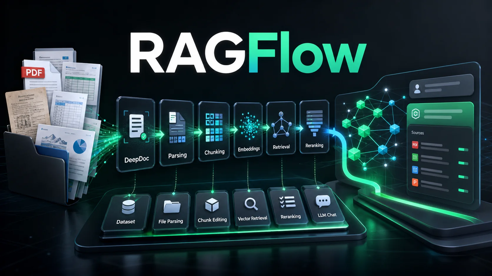

# RAGFlow：深度文档理解驱动的开源 RAG 引擎

**一句话定位：** RAGFlow 是 infiniflow 团队开源的 RAG（检索增强生成）引擎，核心差异点是**深度文档理解（DeepDoc）**——能从复杂格式（PDF、扫描件、表格、幻灯片等）中精准提取结构化知识，配合多路召回+重排序，为 LLM 提供高质量、可溯源的上下文。目前 GitHub 81.6k Stars。

它同时融合了 Agent 能力、MCP 支持、代码执行沙箱和记忆系统，不只是做一个向量检索库，而是想做一套**企业级的 RAG 工作流平台**。




---

## 一、部署方式

### 方式一：Docker 一键部署（推荐）

**硬件要求：** CPU ≥ 4 核，RAM ≥ 16 GB，磁盘 ≥ 50 GB

**前置检查：**

```bash
# 检查 vm.max_map_count，必须 ≥ 262144
sysctl vm.max_map_count

# 不够的话临时设置
sudo sysctl -w vm.max_map_count=262144

# 永久生效写入 /etc/sysctl.conf
echo "vm.max_map_count=262144" | sudo tee -a /etc/sysctl.conf
```

**启动服务：**

```bash
git clone https://github.com/infiniflow/ragflow.git
cd ragflow/docker

# 可选：切换到稳定版本
# git checkout v0.25.6

# CPU 模式启动
docker compose -f docker-compose.yml up -d

# GPU 加速 DeepDoc（需 NVIDIA GPU）
# sed -i '1i DEVICE=gpu' .env
# docker compose -f docker-compose.yml up -d
```

**确认启动成功：**

```bash
docker logs -f docker-ragflow-cpu-1
```

看到 RAGFlow 的 ASCII Logo 和 `Running on all addresses` 即表示启动完成。

**访问：** 浏览器打开 `http://你的服务器IP`，默认端口 80。

> 注意：目前官方只提供 x86 平台的 Docker 镜像，ARM64 需要自行构建。

### 方式二：云服务（免部署）

直接访问 [https://cloud.ragflow.io](https://cloud.ragflow.io) 使用托管版。

### 方式三：源码开发

需要 Python 3.13、Node.js、Docker 基础服务（MinIO、ES/Infinity、Redis、MySQL）。详见官方文档「Launch service from source for development」。

---

## 二、使用前必做：配置 LLM 和 Embedding 模型

首次登录后，需要先配置模型。RAGFlow 不内置商业大模型，需要你自己接入：

**支持的模型来源：**
- OpenAI（GPT 系列）
- Azure OpenAI
- Anthropic（Claude）
- Gemini
- DeepSeek
- 本地模型（Ollama、Xinference、LocalAI 等）
- 各种国内模型厂商（通过 OpenAI-compatible API 接入）

**配置路径：** 登录后 → 右上角头像 → **Model** → 添加模型供应商

一个典型的配置需要设置：
- **Chat Model**：对话用（如 GPT-4o、Claude 3.5 Sonnet、DeepSeek-V3）
- **Embedding Model**：文本向量化用（如 text-embedding-3-small、BGE 系列）
- **Rerank Model**：重排序用（如 BGE-Reranker、Cohere Rerank）

Embedding 和 Rerank 直接影响检索质量，建议不要省。

---

## 三、核心使用流程

RAGFlow 的使用遵循一个标准流水线：

**创建知识库（Dataset） → 上传文件 → 解析/分块（Chunking） → 创建对话助手（Chat）/ Agent → 开始问答**

下面按步骤拆解。

---

## 四、第一步：创建知识库（Dataset）

**路径：** 左侧菜单 **Datasets** → **Create dataset**

创建时需要配置几个关键参数：

| 参数 | 说明 |
|---|---|
| **Name** | 知识库名称 |
| **Embedding Model** | 选择刚才配置的 Embedding 模型 |
| **Chunk Method** | 分块策略，这是 RAGFlow 的核心能力之一 |

### 分块策略（Chunk Method）

RAGFlow 提供了多种针对不同文档类型的分块模板：

| 分块策略 | 适用场景 |
|---|---|
| **Naive** | 通用文本，按固定长度切分 |
| **Manual** | 手动切分，用户自己定义边界 |
| **Q&A** | 问答对格式，适合 FAQ 类文档 |
| **Table** | 表格数据，保留行列结构 |
| **Paper** | 学术论文，按章节结构切分 |
| **Book** | 书籍，按目录层级切分 |
| **Laws** | 法律条文，按条款结构切分 |
| **Presentation** | PPT/幻灯片，按页切分 |
| **Picture** | 图片，用多模态模型理解内容 |
| **One** | 整篇文档作为一个 chunk |

**为什么分块策略很重要？**

RAG 的效果很大程度上取决于 chunk 的质量。RAGFlow 的 DeepDoc 引擎会基于文档结构（标题、段落、表格、图片等）做**智能分块**，而不是无脑按字符数切。比如：

- PDF 论文会按 `标题 → 摘要 → 章节 → 小节` 的层级保留结构
- Excel 表格会保留行列语义
- 扫描件会先 OCR 再按版面结构分块

选好分块策略后，后续上传的文档会自动按这个策略处理。

---

## 五、第二步：上传文件并解析

**路径：** 进入 Dataset → **Files** → **Upload**

**支持的文件格式：**

- 文档：Word（.doc/.docx）、PDF、TXT、Markdown
- 表格：Excel（.xls/.xlsx）、CSV
- 幻灯片：PPT（.ppt/.pptx）
- 图片：PNG、JPG 等（支持 OCR 和多模态理解）
- 网页：URL
- 结构化数据：JSON 等

**上传后的处理流程：**

1. **上传** → 文件存入 MinIO
2. **解析（Parsing）** → DeepDoc 引擎提取文本、表格、图片
3. **分块（Chunking）** → 按设定的 Chunk Method 切分
4. **向量化（Embedding）** → 每个 chunk 生成向量
5. **存入检索引擎** → 默认 Elasticsearch，可切换 Infinity

**人工干预环节：**

RAGFlow 允许你在解析完成后**查看和编辑 chunk**：

- 进入 Dataset → 点击文件 → **Chunks**
- 可以看到每个 chunk 的内容、来源位置
- 支持手动拆分、合并、编辑 chunk
- 支持给 chunk 打标签

这个功能很实在——自动分块不可能 100% 完美，尤其是复杂版面的 PDF 和扫描件，人工微调能显著提升问答质量。

---

## 六、第三步：创建对话助手（Chat）

**路径：** 左侧菜单 **Chat** → **Create chat assistant**

创建对话助手时需要关联一个或多个 Dataset，并配置检索策略：

### 检索配置

| 参数 | 说明 |
|---|---|
| **Datasets** | 关联的知识库（可多选） |
| **Rerank Model** | 重排序模型，提升检索精度 |
| **Similarity Threshold** | 相似度阈值，低于此值的 chunk 会被过滤 |
| **Top K** | 每次检索返回多少个 chunk |

### 多路召回 + 融合重排

RAGFlow 的检索不是简单的向量相似度搜索，而是：

1. **多路召回**：同时用多种方式召回候选（关键词匹配 + 向量相似度 + 全文检索等）
2. **融合重排**：用 Rerank 模型对多路结果重新打分排序
3. **引用溯源**：回答中标注引用来源，点击可跳转到原始 chunk

**对话中使用：**

```text
用户：公司的报销流程是什么？
AI：根据《员工手册》第三章第二节，报销流程如下：[1]
1. 填写报销单...
2. 部门主管审批...
3. 财务审核...

[1] 来源：员工手册.pdf，第 12 页，Chunk #5
```

每个回答底部会显示引用的 chunk，点击可以查看原文，减少幻觉。

---

## 七、第四步：Agent 工作流（进阶）

除了基础的 Chat 问答，RAGFlow 还支持**Agentic Workflow**。

**路径：** 左侧菜单 **Agents** → **Create agent**

Agent 的核心能力：
- **工具调用**：可以调用外部工具（搜索、计算、API 等）
- **MCP 支持**：通过 Model Context Protocol 连接外部服务
- **代码执行**：内置 Python/JavaScript 代码执行沙箱（需 gVisor）
- **记忆系统**：Agent 能记住对话历史和上下文
- **工作流编排**：通过可视化画布编排多步骤任务

### Agent 使用场景举例

1. **研究报告生成**：检索多个知识库 → 综合分析 → 生成结构化报告
2. **数据查询助手**：理解自然语言 → 生成查询逻辑 → 调用代码执行器 → 返回结果
3. **多源信息整合**：同时查内部文档 + 外部网页 + 数据库 → 综合回答

---

## 八、Search 模式：纯检索不带生成

如果你只需要检索相关片段，不需要 LLM 生成回答，可以用 Search 模式：

**路径：** 左侧菜单 **Search**

输入查询后，RAGFlow 会返回：
- 匹配的 chunks
- 相似度分数
- 来源文档和位置

适合用来做文档检索、内容审核、相似度分析等场景。

---

## 九、团队与权限管理

RAGFlow 支持多用户协作：

- **Team**：创建团队，邀请成员
- **权限控制**：不同成员可访问不同的 Dataset 和 Chat
- **对话共享**：可以将某个 Chat 配置分享给团队成员

**路径：** 左侧菜单 **Team**

---

## 十、数据同步：连接外部数据源

RAGFlow 支持从外部系统自动同步数据：

- **Confluence**：自动拉取 Wiki 内容
- **S3**：对象存储中的文件
- **Notion**：笔记页面
- **Discord**：消息记录
- **Google Drive**：云端文档
- **网页爬虫**：指定 URL 自动抓取

配置好后，数据源更新会自动同步到 RAGFlow 中重新解析。

---

## 十一、API 集成：把 RAGFlow 接入你的应用

RAGFlow 提供了 RESTful API，可以把对话能力集成到自己的产品里。

**基础调用流程：**

1. **创建对话会话**
2. **发送消息** → 流式返回回答
3. **获取引用来源**

**Python SDK 示例：**

```python
from ragflow_sdk import RAGFlow

# 初始化
rag = RAGFlow(api_key="your-api-key", base_url="http://localhost:80")

# 获取 Dataset
dataset = rag.list_datasets()[0]

# 创建对话助手
assistant = dataset.create_chat_session(name="客服助手")

# 对话
for chunk in assistant.chat("公司的年假政策是什么？"):
    print(chunk.content, end="")
```

完整的 API 文档参考官方 References 章节。

---

## 十二、架构与核心组件

理解架构对**排查问题**和**性能调优**至关重要。RAGFlow 是一个典型的"主从分布式架构"——前端 + API + 一组无状态 Worker + 一组有状态存储。这一章讲清三件事：**组件角色分工**、**两条关键数据流**、**可替换点**。

### 12.1 全局架构（分层视图）

```
┌──────────────────────────────────────────────────────────────┐
│  接入层                                                       │
│   Web UI (:80)   API Server (:9380)   MCP 接入                │
└──────────────────────────────┬───────────────────────────────┘
                               │
┌──────────────────────────────▼───────────────────────────────┐
│  业务层  (RAGFlow Core 进程)                                   │
│   ├─ 文档处理 Worker  (TaskExecutor)                          │
│   ├─ 对话 / Agent / Search 引擎                                │
│   └─ 代码沙箱  (gVisor 隔离, 可选)                             │
└──────────────────────────────┬───────────────────────────────┘
                               │
┌──────────────────────────────▼───────────────────────────────┐
│  模型层  (可插拔, 外部调用)                                     │
│   Chat Model · Embedding Model · Rerank Model · OCR/多模态     │
└──────────────────────────────┬───────────────────────────────┘
                               │
┌──────────────────────────────▼───────────────────────────────┐
│  存储层  (Docker Compose 内置)                                  │
│   Elasticsearch  ←  向量 + 全文 + 倒排索引                    │
│   MySQL          ←  元数据 / 用户 / Dataset / Chat 配置       │
│   Redis          ←  任务队列 / 缓存 / 会话状态                 │
│   MinIO          ←  原始文件 / 解析中间产物 / 切片图片          │
└──────────────────────────────────────────────────────────────┘
```

### 12.2 核心组件一览

| 组件 | 角色 | 默认端口 | 资源占用 | 关键日志 |
|---|---|---|---|---|
| **Web UI** (nginx) | 反向代理 + 静态资源 | 80 | 极小 | `docker logs docker-ragflow-cpu-1` |
| **API Server** | 业务中枢，对外暴露 RESTful API | 9380 | 中（4-8 GB） | 同上，关注 `/api/v1/...` 路由 |
| **TaskExecutor** | 解析、分块、向量化等长任务 | - | 吃 CPU / 内存 | `task_executor.log` |
| **Elasticsearch** | 向量 + 全文 + 倒排检索 | 9200 | **最吃内存**（建议 heap ≥ 8 GB） | `elasticsearch.log` |
| **MySQL** | 元数据 | 3306 | 轻量 | `mysql.log` |
| **Redis** | 任务队列、缓存、会话 | 6379 | 极轻量 | `redis.log` |
| **MinIO** | 对象存储 | 9000 / 9001 (控制台) | 吃磁盘 | `minio.log` |
| **Sandbox (gVisor)** | Agent 代码执行隔离 | - | 可选 | `sandbox.log` |

> 提示：容器名通常是 `docker-ragflow-cpu-1`、`docker-ragflow-mysql-1` 等，可用 `docker ps \| grep ragflow` 查看。

### 12.3 组件依赖关系

```
ES 启动 → MySQL 启动 → Redis 启动 → MinIO 启动
                                    ↓
                          API Server 启动 → TaskExecutor 启动 → Web UI (nginx)
```

**排查原则**：先看依赖链上游。在 `docker compose ps` 里看到 "Restarting" 的容器，先排它前面的依赖。例如 ES 没起好，下游所有组件都会反复重启。

### 12.4 两条关键数据流

#### 流程 A：文件处理流水线（从上传到可检索）

```
用户上传文件
    │
    ▼
[API Server]  接收 → 校验格式 / 大小
    │
    ▼
[MinIO]       存原始文件，按 dataset_id 分桶
    │
    ▼
[Redis]       入队 task: parse_<file_id>
    │
    ▼
[TaskExecutor] 取出任务
    │
    ├─ 调 DeepDoc 做版面分析（OCR / 表格识别 / 图片提取）
    │
    ├─ 按 Chunk Method 切分
    │
    ├─ 调 Embedding 模型生成向量
    │
    └─ 写入 [Elasticsearch] 索引（每个 chunk 一条 doc，含 text + vector + metadata）
    │
    ▼
更新 [MySQL] 中文件状态为 "parsed"
    │
    ▼
前端轮询，UI 显示 "✅ 解析完成"
```

**排查要点**：
- 文件卡在 "Parsing..."：先看 `task_executor.log`，**DeepDoc 步骤最慢、最容易 OOM**
- 文件解析后搜不到：检查 ES 索引中 `dataset_id` 是否匹配，权限配置是否正确
- Embedding 超时：检查模型 base_url、网络连通性、是否走了代理

#### 流程 B：查询处理流水线（从用户提问到拿到答案）

```
用户提问 "公司年假政策是什么？"
    │
    ▼
[API Server]  接收 → 关联 Chat / Agent 配置
    │
    ▼
[Query 预处理]  ←  RAGFlow v0.20+ 已内置 Query 改写（可选开启）
    │
    ▼
[Elasticsearch] 多路召回
    ├─ 向量召回：top_k × similarity_threshold 过滤
    ├─ 关键词召回：BM25
    └─ 全文召回（可选）
    │
    ▼
多路结果融合 → 送 Rerank 模型重排
    │
    ▼
[Chat Model] 拼装 Prompt（系统提示 + 召回 chunks + 用户问题）→ 流式输出
    │
    ▼
[API Server] 把回答 + 引用 chunk 列表返回前端
    │
    ▼
前端渲染："AI 回答 [1][2]，底部显示来源 PDF / Page / Chunk"
```

**排查要点**：
- 回答慢：80% 卡在 LLM 调用（看 API Server 响应时间分布）
- 答非所问：先关掉 LLM 直接看 Search 结果，判断是召回质量还是生成环节出问题
- 没引用：检查 Chat 配置里是否启用了 Rerank 和引用回传

### 12.5 可替换组件的选型与切换

| 组件 | 默认 | 备选 | 切换建议 |
|---|---|---|---|
| **检索引擎** | Elasticsearch 8.x | Infinity | 数据量 ≥ 千万级、纯向量为主 → 选 Infinity（性能更好、资源占用更低）；否则 ES 稳定且生态全 |
| **文档解析** | DeepDoc | MinerU / Docling | 学术论文（公式多）→ MinerU；复杂版式 PDF → Docling；通用场景 → DeepDoc 已够用 |
| **对象存储** | MinIO | AWS S3 / 阿里 OSS / 腾讯 COS | 生产环境外接 S3 兼容存储更可靠；本地开发用 MinIO |
| **向量库** | 内嵌在 ES / Infinity | - | 不必单独切，ES 本身已是混合检索 |

**如何切换检索引擎**（以 ES → Infinity 为例）：

```bash
# 1. 修改 .env
# DOCUMENT_ENGINE=infinity
# INFINITY_HOST=infinity

# 2. 拉起新组件
docker compose -f docker-compose.yml up -d infinity

# 3. 重建索引（必须！数据格式不兼容）
# 在 Web UI → Dataset → "重建索引"

# 4. 重启 API Server
docker compose restart ragflow
```

> ⚠️ **重要**：切换检索引擎后**所有知识库必须重建索引**——向量字段类型、分片策略、相似度算法都不同，无法平滑迁移。

### 12.6 性能调优实战对照表

| 现象 | 优先查的组件 | 命令 | 优化方向 |
|---|---|---|---|
| 文件解析慢、CPU 满载 | TaskExecutor + DeepDoc | `docker stats` | 升 CPU 核数 / 开 GPU 加速 / 拆分大文件 |
| ES 查询慢、内存满 | Elasticsearch | `curl :9200/_cat/nodes?v` | 加 heap (`ES_JAVA_OPTS=-Xms8g -Xmx8g`) / 加节点 / 切 Infinity |
| LLM 回答慢 | API Server + 上游模型 | 看 nginx 响应时间 | 换更快的模型 / 改流式 / 加缓存 |
| MinIO 磁盘满 | MinIO | `du -sh /var/lib/docker/volumes/...` | 清理失败解析的中间产物 / 加磁盘 / 切 S3 |
| Web UI 加载慢 | Nginx | `docker logs` | 静态资源 CDN 化 / 开启 gzip |

### 12.7 扩展点（自定义你的 RAGFlow）

RAGFlow 在三处留了扩展接口，**不需要改核心代码**，升级时也不会被覆盖：

- **自定义文档解析器**：在 `deepdoc/parser` 下实现，注册到 `task_executor` 即可
- **自定义 Embedding / Rerank 模型**：只要符合 OpenAI 兼容 API 规范，就能在 Model 配置里加
- **MCP 工具**：在 Agent 配置里接入外部 MCP Server，扩展 Agent 能力

生产部署推荐至少补两层：HTTPS（前置 Nginx/Caddy）+ 监控（Grafana + Prometheus，把上面那张表里的指标都接上）。

---

## 十三、常见问题与调优建议

### 1. 问答质量差，经常答非所问

**排查方向：**
- Chunk 质量：进入 Dataset → 检查 chunk 是否把关键信息切碎了
- 相似度阈值：调低 Top K 或降低 Similarity Threshold
- Rerank 模型：确保配置了 Rerank，纯向量检索精度有限
- 文档格式：扫描件/图片是否成功 OCR？

### 2. 解析速度慢

- DeepDoc 的 OCR 和版面分析是 CPU 密集型任务，建议用 GPU 加速
- 大文件可以拆分成小文件分批上传

### 3. 部署后无法访问

- 检查 `vm.max_map_count` 设置
- 检查 Docker 日志确认服务完全启动
- 防火墙是否放行了对应端口

---

## 十四、写在最后

RAGFlow 不是又一个简单的「上传文件 → 向量检索 → LLM 回答」的玩具项目。它在**文档解析深度**和**分块智能度**上下了真功夫，配合多路召回、重排序、引用溯源，确实能在企业复杂文档场景下给出更可靠的回答。

加上 Agent 工作流、MCP、代码沙箱和记忆系统，它正在从一个 RAG 引擎向一个**企业知识处理平台**演进。

如果你的场景涉及大量非结构化文档（合同、论文、手册、报表），且对回答的准确性和可追溯性有要求，RAGFlow 值得认真评估。

GitHub：https://github.com/infiniflow/ragflow  
文档：https://ragflow.io/docs/dev/  
云服务：https://cloud.ragflow.io
