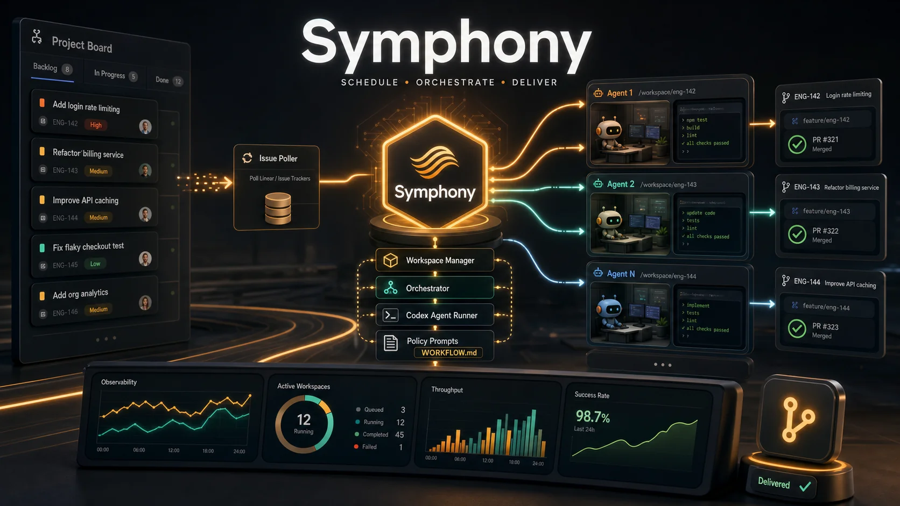

# Symphony 入门：把 Linear 看板变成自主编码 Agent 工厂

**一句话定位：** Symphony 是 OpenAI 开源的**多 Agent 任务调度服务**，核心卖点是**让团队管理"工作"而不是"监督 Agent"**——你只需要把任务放到 Linear 看板里，Symphony 会自动派发到独立的 workspace 中启动 Codex Agent 去完成，提交 PR，全程无需人工监督。GitHub Stars 已超过 24.9k，目前是工程预览版。

> ⚠️ Symphony 是低层次的工程预览版（low-key engineering preview），主要供在受信环境中测试使用。




---

## 一、什么是 Symphony

Symphony 不是单个 Agent 工具，而是一个**长跑型调度服务**，它做了四件事：

1. **从 Linear 拉取工作**：定期轮询 Linear 看板上的可执行任务
2. **创建独立 workspace**：每个 issue 一个隔离的工作目录
3. **派发 Agent 执行**：在 workspace 中启动 Codex（App Server 模式）跑任务
4. **持续跟进直到完成**：Agent 自动完成开发、提交 PR、标记 Linear issue

整个过程是**可重复的守护进程工作流**，不是一次性脚本。Symphony 解决的核心问题是：

- 把 issue 执行变成可重复的 daemon 流程
- 在每个 issue 独立的 workspace 中隔离 Agent 执行
- 团队把 Agent prompt 规则版本化在 `WORKFLOW.md` 里
- 提供足够多的可观测性来同时运营多个并发 Agent

---

## 二、设计哲学：从"管理 Agent"到"管理工作"

OpenAI 提出 **Harness Engineering**（驾驭工程）的概念：让代码库本身为 Agent 准备好一切——可观测性、错误处理、明确的指令。Symphony 是这个理念的下一步：

- **过去**：工程师盯着 Codex、Codex CLI 跑一会儿
- **现在**：把工作丢进 Linear，Symphony 派 Agent 跑，跑完 PR 自动开好

Symphony 自身只做调度（scheduler/runner）和看板读取（tracker reader）。具体怎么改 ticket、怎么发评论、怎么提 PR——这些逻辑都写在 `WORKFLOW.md` 的 prompt 模板里，由 Codex Agent 自己执行。

---

## 三、架构概览

Symphony 用 Elixir/OTP 编写，参考实现包含以下核心组件：

```
┌─────────────────────────────────────────────┐
│           Orchestrator（调度器）              │
│  - 轮询节奏控制                              │
│  - 并发控制                                 │
│  - 重试与回退                                │
└─────────────────────────────────────────────┘
            │               │
            ▼               ▼
┌─────────────────┐  ┌─────────────────┐
│  Issue Tracker  │  │  Workspace Mgr  │
│  Client (Linear)│  │ (per-issue 目录) │
└─────────────────┘  └─────────────────┘
                              │
                              ▼
                    ┌──────────────────┐
                    │   Agent Runner   │
                    │  Codex app-server│
                    └──────────────────┘
```

### 三个主要分层

| 分层 | 职责 | 实现位置 |
|---|---|---|
| **Policy Layer（策略层）** | 团队自定义规则、prompt 模板 | `WORKFLOW.md` 仓库内 |
| **Coordination Layer（协调层）** | 轮询、调度、并发、重试 | Orchestrator |
| **Execution Layer（执行层）** | 文件系统 lifecycle、Agent 子进程 | Workspace + Codex |
| **Integration Layer（集成层）** | Linear API 适配 | Issue Tracker Client |
| **Observability Layer（可观测性）** | 日志 + 可选 Dashboard | Logger + Phoenix LiveView |

---

## 四、安装与运行

### 方式一：用参考实现（Elixir）

**前置要求：**

- Elixir/Erlang（推荐用 [mise](https://mise.jdx.dev/) 管理版本）
- Linear Personal API Key

**运行步骤：**

```bash
git clone https://github.com/openai/symphony
cd symphony/elixir
mise trust
mise install
mise exec -- mix setup
mise exec -- mix build
mise exec -- ./bin/symphony ./WORKFLOW.md
```

启动后服务会开始轮询 Linear，按 `WORKFLOW.md` 配置派发任务。

### 方式二：让 Agent 帮你实现

最简单的方式是让 Codex 帮你搭建：

> Implement Symphony according to the following spec:
> https://github.com/openai/symphony/blob/main/SPEC.md

或者用现有参考实现做底座：

> Set up Symphony for my repository based on
> https://github.com/openai/symphony/blob/main/elixir/README.md

### 启动参数

```bash
./bin/symphony /path/to/your/WORKFLOW.md
```

可选参数：

| 参数 | 默认值 | 说明 |
|---|---|---|
| `--logs-root` | `./log` | 日志目录 |
| `--port` | 禁用 | 启动 Phoenix 可观测性服务（Web Dashboard + JSON API）|

---

## 五、核心配置：WORKFLOW.md

`WORKFLOW.md` 是 Symphony 的"灵魂"——它用 YAML front matter 配置运行时，Markdown body 作为 Codex Agent 的 prompt 模板。

### 最小配置示例

```md
---
tracker:
  kind: linear
  project_slug: "your-project"
workspace:
  root: ~/code/workspaces
hooks:
  after_create: |
    git clone git@github.com:your-org/your-repo.git .
agent:
  max_concurrent_agents: 10
  max_turns: 20
codex:
  command: codex app-server
---

You are working on a Linear issue {{ issue.identifier }}.

Title: {{ issue.title }}
Body: {{ issue.description }}
```

### 关键配置项

| 字段 | 作用 |
|---|---|
| `tracker.kind` | 看板类型（目前支持 `linear`）|
| `tracker.project_slug` | Linear 项目标识 |
| `tracker.api_key` | 默认从 `LINEAR_API_KEY` 环境变量读 |
| `workspace.root` | workspace 根目录 |
| `hooks.after_create` | 创建 workspace 后执行的命令（如 `git clone`）|
| `agent.max_concurrent_agents` | 最大并发 Agent 数 |
| `agent.max_turns` | 单次会话最大轮次（默认 20）|
| `codex.command` | Codex 启动命令 |
| `codex.approval_policy` | 审批策略（`untrusted` / `on-failure` / `on-request` / `never` / `reject`）|
| `codex.thread_sandbox` | 沙箱模式（`read-only` / `workspace-write` / `danger-full-access`）|

### 环境变量支持

```yaml
tracker:
  api_key: $LINEAR_API_KEY
workspace:
  root: $SYMPHONY_WORKSPACE_ROOT
codex:
  command: "$CODEX_BIN --config 'model=\"gpt-5\"' app-server"
```

- `~` 自动展开为 home 目录
- `$VAR` 形式的值会被环境变量替换

---

## 六、使用流程

### 1. 准备代码库

按 [Harness Engineering](https://openai.com/index/harness-engineering/) 的原则，让你的代码库对 Agent 友好：

- 提供清晰的 README
- 配置好 CI
- 准备好 issue 模板
- 让 Agent 可以自助完成 setup

### 2. 申请 Linear API Key

- Linear → Settings → Security & access → Personal API keys
- 设置环境变量：

  ```bash
  export LINEAR_API_KEY="lin_api_***"
  ```

### 3. 准备 WORKFLOW.md

1. 把 `elixir/WORKFLOW.md` 复制到你的仓库根目录
2. 修改 `tracker.project_slug`：右键 Linear 项目 → 复制 URL → 提取 URL 中的 slug 部分
3. 根据需要调整 prompt 模板

### 4. 配置自定义状态

Symphony 的参考实现依赖几个非标准的 Linear 状态，需要在 Linear 的 **Team Settings → Workflow** 中创建：

- **Rework** — Agent 自评未通过，需要重做
- **Human Review** — 等待人工审核
- **Merging** — 准备合入

### 5. 可选：复制 Skills

参考实现提供了几个仓库级 skills，建议复制到自己的 `.codex/` 目录：

- `commit` / `push` / `pull` / `land` — Git 流程
- `linear` — 通过 Symphony 暴露的 `linear_graphql` 工具直接做 Linear 操作

### 6. 启动服务

```bash
mise exec -- ./bin/symphony ./WORKFLOW.md
```

服务启动后会开始轮询，按 `WORKFLOW.md` 的策略自动派发任务。

---

## 七、运行机制详解

### Issue 生命周期

```
Linear (Todo)
   │
   ▼ Symphony 轮询发现
Workspace 创建 → Codex 启动
   │
   ▼ Agent 开发
PR 提交
   │
   ▼ 状态流转
Human Review → (人工批准) → Merging → Done
   │
   ▼ 终态
Workspace 清理
```

如果 issue 进入 `Done` / `Closed` / `Cancelled` / `Duplicate` 终态，Symphony 会自动停止该 issue 的 Agent 并清理 workspace。

### 阻塞（Blocked）处理

当 Codex 报告需要：
- 操作员输入
- 审批确认
- MCP elicitation

Symphony 会把该 issue 标记为 **blocked**，暴露在：

- 运行时状态（in-memory）
- JSON API
- Web Dashboard

重启 orchestrator 后，blocked map 会被清空，issue 可以重新成为派发候选。

### 重试与恢复

- **重试策略**：瞬时失败使用指数退避
- **重启恢复**：基于 Linear 状态 + workspace 文件系统重建调度状态，不依赖持久化数据库

---

## 八、可观测性

Symphony 自带两层可观测性：

### 1. 结构化日志

所有运行时事件输出为结构化日志，可配置 sink。

### 2. Phoenix LiveView Dashboard（可选）

启动时加 `--port` 参数：

```bash
./bin/symphony ./WORKFLOW.md --port 4000
```

启用后可访问：

| 端点 | 说明 |
|---|---|
| `/` | LiveView Dashboard，实时显示所有活跃 run |
| `/api/v1/state` | JSON API，返回当前调度状态 |
| `/api/v1/<issue_identifier>` | 单个 issue 的详情 |
| `/api/v1/refresh` | 手动触发刷新 |

Dashboard 适合在浏览器里观察多个 Agent 同时跑的场景，调试时尤其有用。

---

## 九、测试

### 单元测试

```bash
make all
```

### 端到端测试

⚠️ 端到端测试会在 Linear 上创建**真实的临时项目 + issue**，并跑真实的 Codex app-server session：

```bash
cd elixir
export LINEAR_API_KEY=***
make e2e
```

测试完成后会标记 Linear 项目为 completed，保留可见记录。

可选环境变量：

- `SYMPHONY_LIVE_LINEAR_TEAM_KEY` — 默认 `SYME2E`
- `SYMPHONY_LIVE_SSH_WORKER_HOSTS` — 用真实 SSH 主机测试（逗号分隔）

---

## 十、自定义场景

### 在自己的语言/框架中实现

参考 [SPEC.md](https://github.com/openai/symphony/blob/main/SPEC.md) 是一份语言无关的规范。如果想用 Python / Go / Rust 等实现自己的版本：

1. 阅读 `SPEC.md`（v1 草案）
2. 实现六个抽象层：Policy / Configuration / Coordination / Execution / Integration / Observability
3. 接 Linear API + Codex app-server

### 调整调度策略

修改 `WORKFLOW.md` 的 `agent` / `codex` / `workspace` 字段即可调整：

- 并发数（`max_concurrent_agents`）
- 单次任务最长轮次（`max_turns`）
- 沙箱安全策略（`codex.thread_sandbox`）
- 审批策略（`codex.approval_policy`）

### 自定义 Hook

`hooks.after_create` 支持任意 shell 命令，常用于：

- `git clone` 拉代码
- 装依赖（`npm install` / `pip install` / `mise install`）
- 创建配置文件
- 启动开发服务

---

## 十一、安全与信任

⚠️ **重要边界说明：**

- Symphony 本身**不做** sandbox 控制，依赖 Codex + 操作系统层面的安全机制
- 不同的实现可以采取不同的安全策略
- **官方推荐在受信环境（trusted environments）中测试**
- 你的 prompt 模板决定 Agent 能做什么——`WORKFLOW.md` 是安全策略的核心

部署前请确认：
- Linear API Key 的权限范围
- Codex app-server 的审批策略
- workspace 目录的隔离是否充分
- Git 仓库的访问控制

---

## 十二、写在最后

Symphony 代表了 Agent 工具演进的一个方向：**从"我用一个 Agent 写代码"到"我用 Agent 团队按工单交付"**。它不是一个开箱即用的产品，而是一份工程蓝图 + 一个参考实现。

如果你：
- 团队已经用 Linear 管理任务
- 想尝试把常规开发任务交给 Agent 跑
- 愿意自己调整 prompt 策略和 sandbox 边界
- 想研究多 Agent 调度的工程实践

Symphony 值得认真读一读 `SPEC.md`，然后用 Codex 帮你搭一个试试。

仓库：https://github.com/openai/symphony  
规范：https://github.com/openai/symphony/blob/main/SPEC.md  
视频演示：https://player.vimeo.com/video/1186371009  

---

**相关工具：**

如果你想让多个 AI Agent 共享一套 API Key，或者想统一管理 Claude、GPT、Gemini 等多模型的用量和计费，可以了解一下 [EbeeAI](https://ebeeai.net)。它是面向开发者的 AI API 网关与多模型统一接入平台，可以把模型账号管理、API Key 轮换、用量统计和按量计费集中起来。Symphony 跑多 Agent 任务时，配套用这类工具管理模型账号，团队成本会更可控。新用户注册后有 $10 试用额度，适合先跑小规模 Agent 任务做验证。
